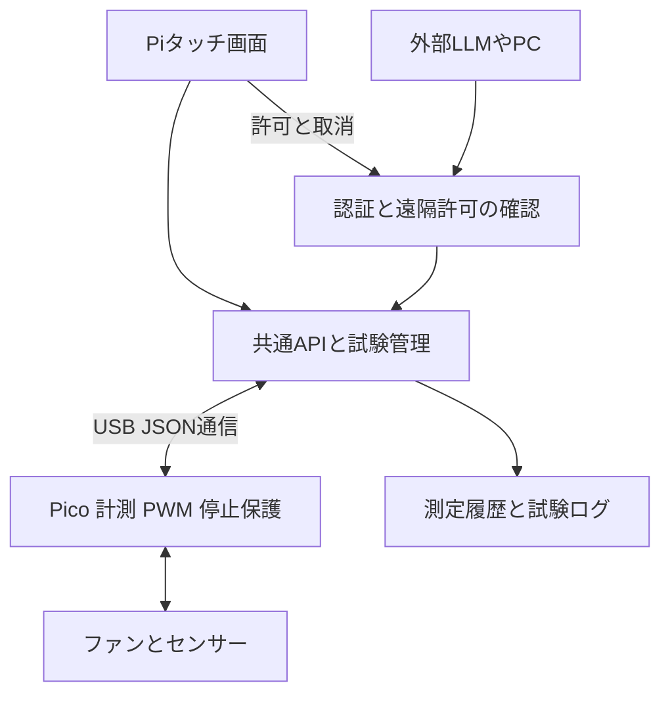

# Wind Tunnel 制御ソフトウェア基本設計

2026年10月17日 / 0.3.0 実機有限運転版まで反映。対象はPico Carrier Rev Eと現在のRaspberry Pi。未実装の拡張要件は本文で区別する。

Piのタッチ画面から試験を実行でき、外部LLMやPCも同じAPIで状態確認・試験作成・結果取得を行える構成とする。制御の判断を共通化し、Picoが計測、PWM生成、通信断時の停止を担当する。LLMはPi上で動かす必要がない。

外部APIからの運転は、**本体の遠隔モードON、有効な許可IP、操作権限を持つAPIトークン認証の3条件すべて**を満たす場合だけ認める。ユーザー合意済みの方式として採用する。遠隔OFFは新規開始の禁止に加え、進行中の遠隔試験の停止を伴う。

PCの模擬版と、Pi本体の[実機有限運転UI/API](../../../software/control/README.md)を実装した。常駐Pico FWは0.3.0-control、protocol 2を使う。Tach常時計数・PWM・センサー3種・2秒通信更新期限・3秒WDTを備える。配線・画面回転・固定IPは変更しない。実機検証の範囲と数値は[有限運転版の記録](../../tests/software/pico-control/README.md)を参照する。

## 現在の実装範囲

| 実装済み | 今後の実機対応 |
|---|---|
| 800×480向けUI、Pi実画面表示とkiosk起動 | 指によるタッチ操作感・長時間負荷確認 |
| 三条件の遠隔認証、トークン発行と失効、ローカル専用設定 | TLS、LAN公開、運用時の認証強化 |
| 約2 Hzの実センサーとTach表示、有限PWM、Pico独立停止監視 | 長時間負荷、障害下の実停止時間の追加評価 |
| SQLite記録、CSV/JSON出力、模擬障害と異常解除 | 定常判定・統計比較・実機校正・データ保持運用 |
| ポーリング、OpenAPI、API/ブラウザー自動テスト | SSE配信・USB断/実ハードウェア保護の検証 |

`--backend simulation`、旧 `pico-monitor`、現行 `pico-control` を分離する。`simulation=false` は実センサー値を示し、運転能力は `fan_control_available` で判断する。現行版はtrue、旧停止専用版はfalseで開始を拒否する。模擬値と実測値は画面・API・DB保存先で区別する。

## 現在の実機と実装の境界

| 項目 | 確認した状態 |
|---|---|
| Pi | Raspberry Pi 3 Model B Plus、armhf / armv7l。接続先IPはローカル設定で管理 |
| 実行環境 | Python 3.13.5、labwc 0.9.7、Firefox 151.0.3 kiosk |
| 画面 | DSI-1、800×480、回転180度、scale 1。タッチ補正は維持 |
| リソース | メモリ総量920 MiB、調査時available約695 MiB、root空き約8.2 GiB |
| API | FastAPI 0.115.11-4 / uvicorn 0.32.0-3、OSパッケージで導入済み |
| Pico | RP2040、USB CDC、GP16は25 kHz PWM、停止時LOW。GP15は入力専用のPWM7 Bハードウェア計数 |
| センサー | SDP810-125Pa、BME280、INA260。約2 Hzで全3種を取得した実績あり |
| 現在の常駐FW | 0.3.0-control。sample/status/stop/arm/drive/ack/reboot。起動・復旧時に自動運転しない |
| 最新試験 | 20～100%の短時間段階試験に成功。RPMは2 pulse/rev仮定。独立校正値ではない |

オシロ比較は今回の開発工程に含めない。現在の回転数は仮定を明示して利用し、独立校正済みとは表示しない。差圧配管の対応と校正が未確定なので、初版は風速を表示・制御しない。

## システム構成



| 層 | 初版の候補 | 責務 |
|---|---|---|
| タッチUI | 静的HTML/CSS/JavaScript、Firefox kiosk | 状態表示、試験設定、開始と停止、履歴、遠隔許可 |
| API | Python、FastAPI、uvicorn | JSON契約、認証、入力検証、OpenAPI、データ配信 |
| 試験管理 | 同じPiサービス内の単一制御担当 | 操作の排他、段階実行、上限、記録、停止優先 |
| 記録 | SQLiteとCSV/JSONエクスポート | 測定値、元フレーム、条件、エラー、操作者の保存 |
| Pico FW | 既存MicroPythonを基にした常駐計測制御版 | Tachハードウェア計数、センサー取得、PWM、独立タイムアウト |

Web UIの静的ファイルはPiに同梱し、運転中にCDNやインターネットを必要としない。初版はNode.js常駐サーバー、Docker、クラウド接続を必須にしない。

FastAPIはOpenAPIと入力モデルからAPI仕様書を生成できるため、UIとLLMクライアントの契約を共通化しやすい。[FastAPI公式](https://fastapi.tiangolo.com/features/)

Pi公式にもChromiumとlabwcを使うkiosk構成がある。ただし公式手順は64 bit OSを前提にしているため、そのまま適用せず、現在の32 bit環境で表示と負荷を確認する。[Pi公式kiosk手順](https://www.raspberrypi.com/tutorials/how-to-use-a-raspberry-pi-in-kiosk-mode/)

## 初版の機能範囲

1. 全センサーのライブ表示、計測品質、更新時刻、Pico接続状態の表示。
2. PWM固定運転と、停止を含む複数段階の試験。いずれも最大実行時間を持つ。
3. 測定記録、試験条件、CSV/JSONの出力、過去試験の比較。
4. 本体画面からの開始・停止と、時間制限のない遠隔操作許可。LAN公開は後続工程。
5. 認証APIからの状態読取り、試験検証・開始・取消、結果取得。
6. 実機を使わずUI/APIを開発できるシミュレーションモード。

初版では、RPM一定制御、風速一定制御、ピトー管の自動移動、任意Python実行、LLMが生成したコードの実機実行を含めない。将来のRPM制御は計数の品質表示を維持して追加する。風速制御は差圧の符号・圧力対応・密度補正・ゼロ点の扱いを確定してから追加する。

## タッチ画面

800×480を基準に、上部に状態、下部に4つの画面切替を置く。実装時に原寸の実機タッチ確認を行う。画面回転と座標変換はOS側の既存設定を使い、アプリで二重に反転させない。

| 画面 | 表示と操作 |
|---|---|
| モニター | 推定RPM、符号付き差圧を大きく表示。温湿度・気圧・電圧・電流・電力、直近のトレンド |
| テスト | プリセット選択、PWM・段階時間・収録時間の編集、条件確認、開始、進捗、停止 |
| 履歴 | 日時、試験名、成功/中止/異常、条件、平均/ばらつき、CSV/JSON取得 |
| 設定 | センサー・通信の診断、校正メタデータ、APIクライアント、遠隔許可ON/OFF |

全画面で「停止」を常時表示する。モーダルや数値入力キーボードで停止を隠さない。起動操作は条件確認後、停止操作は追加確認なし。指で操作する主要ボタンは原則48 px以上とし、スライダーだけに頼らず数値と増減ボタンを併用する。

上部には本体操作・遠隔許可・停止・異常を文字で表示し、色だけに頼らない。遠隔時は実行試験の所有者を表示し、設定画面には無期限の許可とOFF操作を設ける。取消は遠隔試験の停止と制御権失効を伴う。

表示上の区別を徹底する。

- 「PWM指令」と「Picoが適用した設定値」は別に保持する。端子波形を実測した値とは呼ばない。
- 「停止指令済み」と「Tachパルスなし」は別状態。接続断やTach異常時に物理停止確認済みと表示しない。
- 古い値は更新時刻付きで灰色表示し、現在値と混ぜない。未取得は `—`、APIでは `null`。
- `SIMULATION` を画面・API・記録すべてに表示する。実測値に混ぜない。
- SW1の位置はGPIOで直接検出していない。「SW1 ON」と断定せず、INA260による「ファン電源あり/不足/不明」を表示する。

## 試験の実行方法

試験は有限のレシピとして実行する。UIとAPIで同じレシピ検証・実行機能を呼ぶ。開始前に、Pico識別と対応FW、必要センサーの最新値、給電、保存領域、制御権、適用上限を確認する。`0.1.0-commissioning` のままなら開始を拒否する。

レシピは、試験名、制御方式、各段階のPWM、整定待ち時間、記録時間、繰返し数から成る。初版は制御方式 `pwm` のみ。手動固定運転も単一段階レシピとして時間上限を設定する。

段階ごとに「整定待ち」と「集計対象」を分離し、整定待ち中の生データも保存する。時間が経っただけでは物理的に整定したと判定しない。一定窓のRPM・差圧の傾きやばらつきを記録し、条件外なら `settled=false` を付ける。自動延長を入れる場合も延長上限を必須にする。

最初の実機プリセットは、今回確認した0→20→40→60→80→100→0%と各10秒の運転を再現するものとする。ソフト設計上のPWM範囲は0～100%だが、初版の運転開始範囲は検証済みの20～100%とし、0%は停止に使う。低速域や長時間保持の許可は段階的に追加する。画面・APIの上限チェックを、実機試験済みの安全性保証と取り違えない。

現行実装の状態は `IDLE → ARMING → RUNNING → STOPPING → COMPLETED`。ARMINGはPicoの運転許可応答待ち、STOPPINGはPWM 0応答待ちである。ユーザー中止は `CANCELLED`、異常は `FAILED`、再起動で中断した試験は `INTERRUPTED` とする。停止応答が3秒以内に確認できなければFAILEDとし、正常完了にしない。

開始要求は `202 Accepted` と `run_id` を返し、実際の成否はrun状態で確認する。通信タイムアウト時に「新しい開始」を繰り返さず、同じ冪等キーで状態を照会する。同一キー・同一内容は同じrun、同一キー・異なる内容は409とする。作成とキーの記録は原子的に行い、重複運転を防ぐ。

## 遠隔許可と操作の競合

初期状態は遠隔操作OFF。外部クライアントの読取り権限は別に管理できるが、運転権限があっても本体側の許可がなければ開始できない。

本体画面だけが遠隔モードをON/OFFできる。ONには時間制限を設けない。クライアントごとに許可IPとread/plan/control/stop権限を登録する。複数の登録クライアントが認証できても、同時に試験を所有できるのは1クライアントだけ。LLMは自分でON・許可IP変更・トークン発行を行えない。無期限は再起動をまたぐ永続許可ではなく、認証や安全解除を省略する意味でもない。

| 要求 | 必須条件 |
|---|---|
| 遠隔から試験開始 | 遠隔ON＋登録IP一致＋有効トークンのcontrol権限＋制御権空き＋PWM/試験時間上限。停止専用実機版では不可 |
| 状態・履歴取得 | 登録IP一致＋有効トークンのread権限。遠隔OFFでも読取り可 |
| レシピ検証 | 登録IP一致＋有効トークンのplan権限。回転を開始しない |
| 停止・取消 | 登録IP一致＋有効トークンのstop権限。遠隔OFFや他者所有でも停止可 |
| 遠隔ON/OFF・クライアント設定 | 本体専用セッション＋Origin/CSRF検証。外部APIトークンでは不可 |

IPは接続ソケットのpeerアドレスと照合する。クライアント申告値、`X-Forwarded-For`、`Forwarded`を信用しない。模擬版の起動処理ではuvicornのproxy_headersを無効化し、Hostも固定する。許可リストは初期空、IPv4/IPv6の個別アドレスのみ。CIDR、ワイルドカード、ホスト名は拒否する。IPv4-mapped IPv6はIPv4へ正規化する。DHCP予約等によるIP安定化はLAN導入時に行う。[Uvicorn公式設定](https://raw.githubusercontent.com/encode/uvicorn/master/docs/settings.md)

APIトークンはクライアントごとのランダム値を発行し、一度だけ本体画面で提示する。保存するのはSHA-256ハッシュであり平文ではない。SSHパスワードと共用しない。失効時にそのクライアントの進行中試験も停止する。許可IP変更は初版では古いトークンを失効させて新規登録する。

制御権の所有者は1つだけ。ローカル運転中の遠隔開始、遠隔運転中の別クライアント開始は409で拒否する。停止は制御権の所有者以外でも、停止権限を持つ認証クライアントと本体UIから実行できる。ローカルへ切り替える際は、遠隔試験を停止してから新しい制御権を発行する。

10分の許可タイマーと残時間による試験開始制限は撤廃した。`remaining_s` と `expires_at` はnull、`unlimited=true`を返す。OFF・停止操作・再起動・異常・本体UIの生存確認が5秒途絶えた場合は許可を取り消し、自動再許可しない。正常な1秒周期の生存確認で本体の認証Cookieを更新し、8時間経過だけでは失効させない。個々の試験は最大300秒のままとし、無限運転は許可しない。

APIの開始要求が完了した後、HTTP接続やLLMの応答待ち自体を継続条件にしない。許可された有限試験はPiが管理する。ただし本体許可、Picoへの運転許可更新、最大実行時間は常に有効でなければならない。

「本体からの許可」をリクエスト本文の `source=local` や接続元IPだけで判定しない。専用kioskセッションにだけ許可操作の権限を付ける。kiosk資格情報はPiのGUIユーザー専用領域から一回限りのローカル初期化で発行し、外部APIトークンには発行権を与えない。CookieはHttpOnly/SameSite、TLS時Secureとし、CSRFとOrigin/Hostを検証する。端末自体の管理者権限は信頼境界外とする。

## API契約

APIは `/api/v1` を共通接頭辞とする。下表のうちSSE以外は模擬版に実装した。実機版もPiのloopbackで配備済みだが、運転・レシピ検証・模擬障害注入は拒否する。実際の入力スキーマは `/openapi.json` を正とする。

| メソッドとパス | 内容 | 権限と条件 |
|---|---|---|
| `GET /api/v1/status` | 接続、機器状態、操作所有者、実行run、故障理由 | read |
| `GET /api/v1/capabilities` | FW、センサー、制御方式、上限、校正状態 | read |
| `GET /api/v1/telemetry/latest` | 値、単位、元時刻、鮮度、有効性 | read |
| `GET /api/v1/events` | SSE配信は後続工程。模擬初版はstatusの2 Hzポーリング | 未実装 |
| `POST /api/v1/runs/validate` | 有限レシピの検証、見積時間と制約。運転しない | plan |
| `POST /api/v1/runs` | 検証済みレシピから試験開始 | control、制御権、遠隔なら本体許可 |
| `GET /api/v1/runs` | 試験履歴。ページング必須 | read |
| `GET /api/v1/runs/{id}` | 進捗、結果、停止・異常理由 | read |
| `POST /api/v1/runs/{id}/cancel` | 試験中止。既に終了済みなら状態を返す | stop |
| `POST /api/v1/stop` | 全運転停止、保留操作の無効化 | stop。制御権と遠隔許可の有無を問わない |
| `GET /api/v1/runs/{id}/export?format=csv` | CSV取得。jsonも選択可能 | read |
| `GET /api/v1/control/remote-permit` | 許可状態・無期限の識別・上限 | read |
| `POST /api/v1/control/remote-permit` | 本体から無期限許可を作成。duration_sは廃止 | kiosk専用 |
| `DELETE /api/v1/control/remote-permit` | 許可取消と遠隔運転停止 | kiosk専用 |
| `POST /api/v1/faults/acknowledge` | 停止・異常原因解消後の確認。回転は再開しない | kiosk専用 |
| `POST /api/v1/local/session` | 一回限りの本体資格情報をCookieへ交換 | loopback＋専用秘密＋Origin |
| `POST /api/v1/local/heartbeat` | 本体画面の生存確認 | kiosk専用 |
| `GET/POST /api/v1/local/clients` | 許可IP・権限の一覧とトークン新規発行 | kiosk専用 |
| `DELETE /api/v1/local/clients/{id}` | トークン失効、所有する試験の停止 | kiosk専用 |
| `POST /api/v1/local/simulation/fault` | 接続断・センサー・給電異常の模擬注入と原因解消 | 模擬版のkiosk専用 |
| `GET /openapi.json` | 機械可読なAPI仕様 | 配布用。機器秘密を含めない |

例として、外部から単一段階試験を要求するJSONは次の形を候補とする。

```json
{
  "recipe": {
    "name": "PWM 40 percent test",
    "mode": "pwm",
    "steps": [
      {"pwm_percent": 40, "settle_s": 5, "record_s": 5}
    ],
    "repeat": 1
  },
  "control_epoch": 1,
  "remote_permit_id": "example-permit-id"
}
```

`Authorization: Bearer ...` と `Idempotency-Key` をヘッダーで送る。許可IDとcontrol_epochは直前のstatusから取得する。上記の値は例示で、秘密情報でも認証の代替でもない。停止・許可変更でepochが進むため、古い開始要求を拒否できる。`validate` はrecipeだけを受け取り、開始時に許可・状態・上限を再検査する。レシピhashとepochを記録する。同一キー・同一要求の再送は保存済みrunを返し、完了済み試験を再実行しない。

模擬版のエラーJSONは `code`、入力検証時は `fields` を返し、応答ヘッダー `X-Request-ID` で照合する。秘密を入力エラーに反射しない。例は `REMOTE_MODE_OFF`、`IP_NOT_ALLOWED`、`INVALID_TOKEN`、`SCOPE_DENIED`、`CONTROL_BUSY`、`STALE_CONTROL_EPOCH`、`STORAGE_FAILURE`。入力異常422、認証失敗401、権限不足403、状態競合409、機器利用不可503を使い分ける。UIは主要コードを日本語へ変換する。

初版はHTTP JSON＋OpenAPIを優先する。MCPが必要になれば、このAPIを呼ぶ薄いアダプターを追加する。MCPが制御権・遠隔許可・上限を迂回する別経路を持たないようにする。任意シェル、任意GPIO、任意コード実行エンドポイントは提供しない。

## 通信とデータ品質

PiサービスだけがPicoのUSBシリアルを排他オープンする。既存の診断スクリプトを同時実行しない。通常運用はraw REPLへのコード投入ではなく、版管理した常駐FWのJSON行プロトコルを使う。

現行版はprotocol=2、固定FW版・device_id、boot_id、応答seq、要求id、PWMと保護設定を検証する。運転にはPicoのsafety_epoch・arm_idと増加するcommand_seqを使い、停止後の古い指令を拒否する。Picoの生値をPiで補正し、CRC不一致・センサー異常は個別の値をnullにする。詳細は[実装済みの通信仕様](../../tests/software/pico-control/README.md)を参照する。

USBの受信行長とキュー長を制限し、不正JSON、非有限数、範囲外、未知操作を拒否する。運転中の不正制御メッセージや連続通信異常は停止側へ移る。停止処理はログ保存より先に行う。再接続は再識別と停止状態確認から始め、直前のPWMや試験を自動再開しない。

| データ | 保存する情報 |
|---|---|
| 時刻 | Pico boot_id、拡張単調時刻、計数開始/終了、各センサー取得時刻、Pi受信UTC |
| 回転 | 累積カウンタ、差分エッジ数、実際の計数窓、Tach Hz、仮定PPR、推定RPM |
| 圧力 | 符号付き差圧Pa、SDP生フレーム・CRC、ゼロ点ID、配管対応、校正状態 |
| 環境 | 温度℃、RH %、現地気圧Pa、BME工場校正係数・補正式の版 |
| 電源 | INA電圧V、電流A、電力W、設定、測定対象はファン枝路であること |
| 運転 | 要求PWM、適用設定、run_id、段階、整定/記録区分、操作元 |
| 品質 | valid、reason、age_ms、seq欠落、センサー個別エラー、simulation |

現行版はticks_diffでPicoの時刻wrapを扱い、再起動をboot_idで区切る。計数窓はUSB到着間隔から推定せずPico自身の時間で算出する。段階変更時もTach累積計数を継続し、窓の開始・終了PWMと窓内変更フラグを残す。絶対的な拡張Pico時刻や厳密な指令適用時刻は将来要件であり、現在は計数窓・Pico時刻・Pi受信時刻を保存する。

現行の全センサー取得とUI数値更新は約2 Hz、RPM表示は約0.5秒窓の速報値である。平滑値は未実装。Piは取得seqごとに一度保存し、欠落数を明示する。将来更新率を上げる場合、I2C変換時間、USB待ち、Pico停止監視、Pi負荷を先に評価する。

APIは圧力をPa、電流をAなど一貫したSI単位のフィールドで返し、UIでhPa/mAへ変換する。今回の既存記録のmA表現から移す際に単位テストを設ける。風速は初版では `null` と理由を返す。負差圧を無条件で絶対値にして風速へ変換しない。

SSEは表示用の配信であり制御指令を扱わない。遅い閲覧クライアントへの配信は間引き・切断できるが、測定保存やPicoへの停止指令を待たせない。再接続でイベント欠落があれば明示し、最新snapshotを再取得する。古い制御操作は再送しない。[FastAPI StreamingResponse](https://fastapi.tiangolo.com/advanced/custom-response/)

## 停止と保護

Picoを停止保護の最終ソフト層とし、PiのWebサーバーだけに依存させない。起動時はGP16 LOW、運転許可なし。Piは有効な制御状態にある間だけ約250 ms間隔でdriveを送り、Picoは更新が2秒を超えたとき停止する。USBワーカーは制御担当から0.75秒以内に更新がある場合だけdriveを継続する。運転開始時に3秒WDTを有効化し、リセット後は停止に戻す。これらはPWM停止の設定値であり、処理・通信遅延や羽根の惰性を含む物理停止時間ではない。

WDTは安全監視と制御ループの処理後に更新する。別のタイマーで無条件に更新しない。MicroPython WDTは開始後に停止できないため、保守は停止・再起動後の未始動状態で行う。[MicroPython WDT](https://docs.micropython.org/en/v1.26.0/library/machine.WDT.html)

| 事象 | 動作 |
|---|---|
| 停止ボタン/API stop | 最優先でPWM 0、古い運転指令無効、停止要求を記録 |
| USB断・Piサービス停止 | Picoの運転許可失効で停止。Pi表示は接続断/停止未確認 |
| Pico異常 | WDTリセットと起動時停止。復帰後に自動運転しない |
| 遠隔許可の取消 | 遠隔試験停止。時間による失効なし、自動再許可なし |
| UI消失 | 手動操作・遠隔許可を失効させ停止。本体での再確認後に再開 |
| 給電喪失・センサー異常・上限超過 | PWM 0、runを異常終了、fault保持 |
| ディスク満杯・記録キュー停滞 | 記録不能として停止。データを黙って捨てて試験継続しない |
| アプリ/OS再起動 | 未完了runをINTERRUPTEDへ。安全設定を検証して停止待機 |

既存診断の電圧10.8～13.2 V、電流600 mA超即中止・450 mA超2サンプル、差圧絶対値100 Pa超、Tach異常等はレビュー開始点として保持する。恒久版の計測周期やセンサー設定が変われば、連続サンプル条件を時間条件に読み替えて評価する。これらはヒューズ等の電気的保護や安全認証の代わりではない。

停止に対するPicoのACK、適用指令0、Tachの状態を別々に確認する。応答がなければ「停止できた」と断定せず、SW1によるファン電源遮断を案内する。SW1はPiの電源断ではなくファン枝路の遮断。画面上の停止を安全認証された非常停止として表示しない。

## 保存と運用

SQLiteにはrun、レシピsnapshot、samples、events、校正設定、API監査を保存する。SQLiteはローカル機器内の保存先として使い、共有ネットワークドライブにDBを置かない。[SQLiteの用途](https://www.sqlite.org/whentouse.html)

初版は単一writerで短いトランザクションを使う。SQLiteのWALは必須にせず、採用時は実機SQLite版と修正状況を確認する。記録は最大1秒程度のバッチを候補とし、突然の電源断で未commit分が失われることを扱う。書込完了を待ってから成功runとし、SQLiteのバックアップAPI等で整合したコピーを取得する。

キューは有界にして、記録遅延・空き容量を監視する。過去試験を無断で削除して空き容量を作らない。保存容量の上限と削除は管理者設定として別途決める。CSVは単位・品質・run IDを含み、JSONには元フレームと設定を含める。試験名等の自由文字列はHTMLエスケープし、CSVの式実行も防ぐ。

本体のサービスは専用非rootユーザー、必要なUSBアクセス権だけで実行する。APIは1 workerとし、1つの試験管理担当・USB所有者に集約する。USB I/OとDB保存を要求処理のイベントループでブロックさせない。再起動は停止状態で復帰させ、開発用autoreloadを実機運用に使わない。

本体UIはloopbackから利用する。LAN公開は認証とTLSを用意してから有効にし、ルーターのポート開放やインターネットへの直接公開は行わない。最初のAPI検証はSSHトンネルでも実施できる。API用資格情報をSSHパスワードと共用せず、クライアントごとのread/plan/control/stop権限、失効、操作監査を持たせる。Bearerを平文LAN HTTP、URL query、ログに流さない。

## 開発順序と受入条件

| 段階 | 作成物 | 主な受入条件 |
|---|---|---|
| 1 模擬環境 | API契約、800×480画面、レシピ/履歴、模擬Pico | 実機なしでUI試験。REMOTE許可・取消・排他・二重開始を検証 |
| 2 常駐計測 | 停止専用から更新したPico FW、USBプロトコル、記録 | ファン停止で全値・鮮度・時刻wrap・再接続・欠落を検証 |
| 3 有限運転 | PWM試験、停止、fault、権限と上限 | 既存短時間試験を再現。停止後再開なし、偽の完了表示なし |
| 4 本体運用 | kiosk起動、systemd、LAN認証API | 再起動後停止、タッチ原寸、LLMとUIの競合、保存・復旧を検証 |
| 5 拡張 | 定常判定、RPM制御、校正、風速関連 | 必要な計測品質と前提を満たした機能だけ有効化 |

設計上の必須テストは、無許可API開始の拒否、偽local指定の拒否、経過時間に依存しない遠隔許可と安全取消、同時開始1件限定、同一キー再送で重複運転なし、停止直後の遅延指令拒否、USB断・アプリ停止・Pico停止監視、センサー不正値、保存失敗、再起動後の停止である。ハードウェアを故障させる試験ではなく、模擬障害と管理された通信断で検証する。

性能は実機で測定する。候補目標はUI表示2 Hz、操作応答表示250 ms以内、停止要求をPicoへ送るまで250 ms以内、API＋ブラウザー込みで継続的なswap発生なし。通信許可失効とWDTの停止時間も負荷下で確認する。達成できなければ画面描画と集計を軽量化する。

段階1～3の模擬・計測・有限運転を実装した。Piのkioskで実ファンの開始・段階運転・停止を検証した。詳細は[実装README](../../../software/control/README.md)、[Pi配備と運用](../../../software/control/deploy/pi/README.md)、[実機検証](../../tests/software/pico-control/README.md)を参照する。LAN公開、長時間負荷、全故障モード下の保護性能評価、拡張計測・校正は後続工程である。

## 現在の根拠ファイル

- [市販風洞・測定規格・公開UIの調査（2026-10-18）](../../research/wind-tunnel-20261018/README.md): 未実装の拡張提案、校正上の注意、格子治具のCAD参照。現行仕様と区別して扱う。

- [SSH接続の準備](../../operations/SSH_SETUP.md)（実機固有の接続メモはローカル専用）
- [Picoの現在の常駐FW](../../../Electronics/pico/firmware/control_main.py)
- [既存の停止初期化](../../../Electronics/pico/firmware/boot.py)
- [100%段階試験](../../tests/fan-sensors/2026-10-17/TEST_RESULT.txt)
- [Tach改善の検証](../../tests/fan-sensors/2026-10-17/TACH_IMPROVEMENT_RESULT.txt)
- [設計用の実機環境確認](../../tests/software/pi-inventory-20261017.json)
