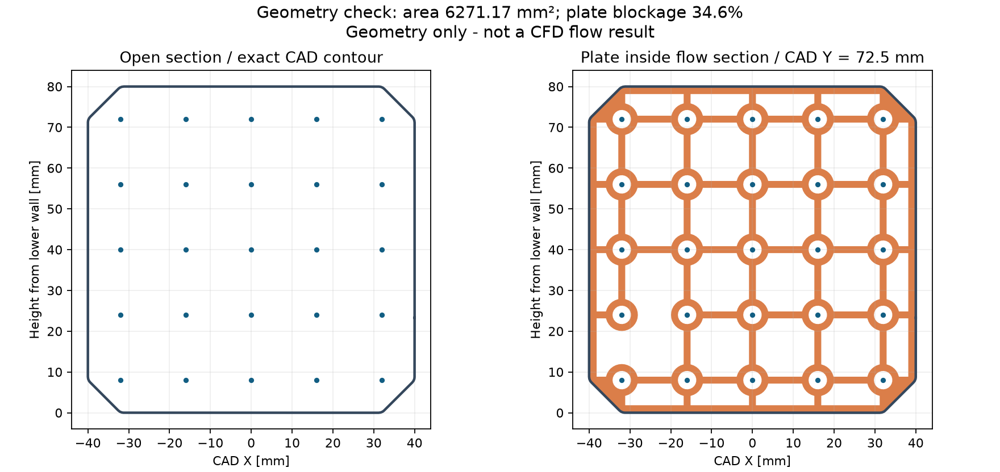
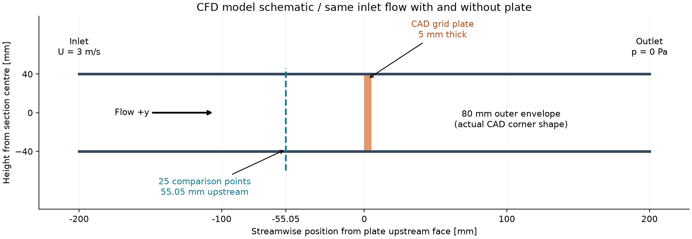
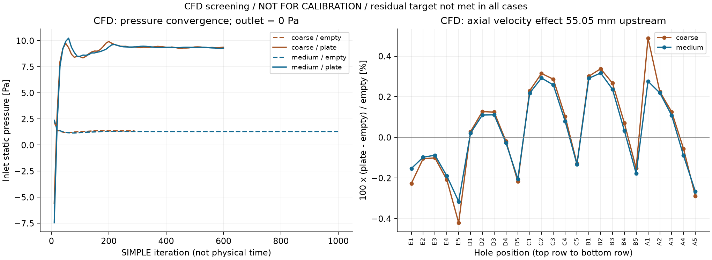
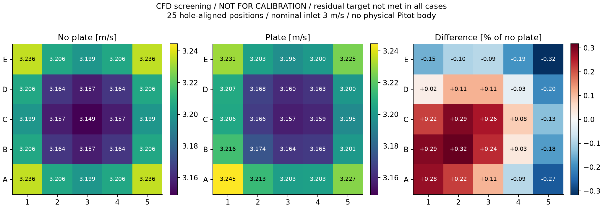
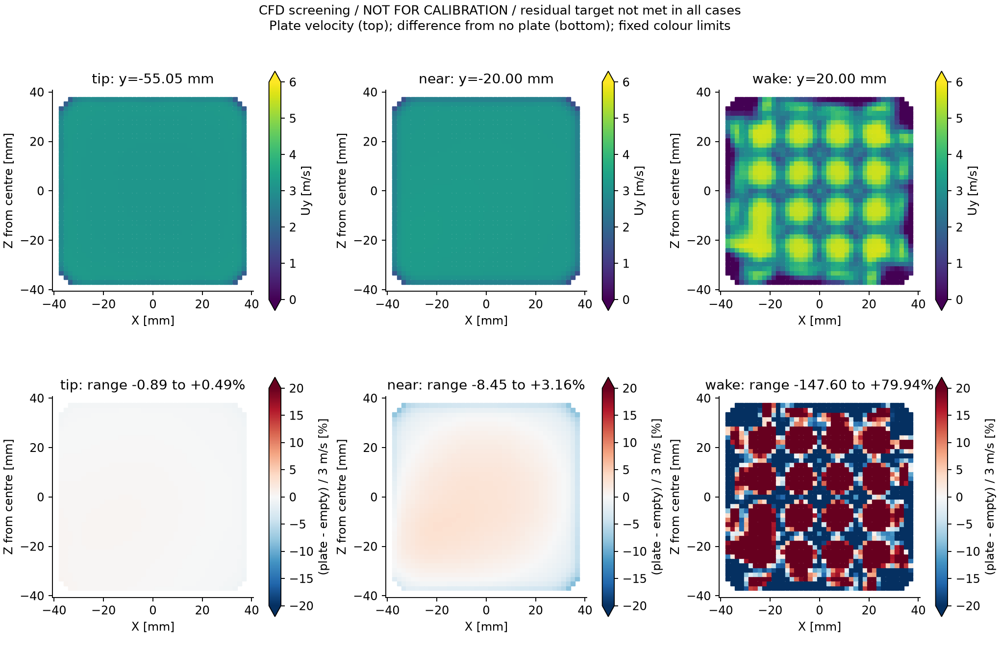
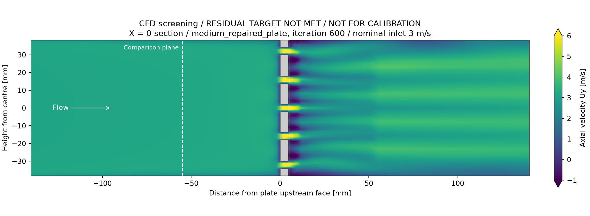

# ピトー管固定板の影響の予備CFD評価

2026年10月18日。対象はFusionの `merged model v49` にある `Pitotube plate`。

## 結論

固定板を「流れに影響しない位置決め治具」とみなすことは勧めない。CAD形状では流路の約34.6%を塞いでおり、3 m/sの固定流量モデルでは、板によって必要な入口静圧が約8 Pa増える参考結果になった。一方、板から約55 mm上流の25点では、板直後に比べて速度変化が小さい傾向が見られた。

**ただし、固定板ありの定常計算は残差基準に達していない。以下のCFD数値は設計検討用の参考値であり、測定誤差の保証、校正係数、または「固定板の影響なし」の判定には採用しない。**

現行治具を使う場合は「固定板を付けた状態の風洞」として条件を固定する。固定板を取り外して使用する場合の風速や空洞分布へ、その校正表をそのまま流用しない。精密に治具なしの風洞分布を測るなら、流路外に主な支持機構を置くトラバースを優先候補とする。現行板の即時廃止が必須とまでは、今回の解析だけでは断定しない。

## CADから確認した値

| 項目 | 値 |
|---|---:|
| 流路の外接寸法 | 80 × 80 mm |
| 内壁輪郭から求めた断面積 | 6,271.168 mm² |
| 板の流路内投影面積 | 2,168.575 mm² |
| 幾何学的閉塞率 | 34.580% |
| 板厚 | 5 mm |
| 格子穴 | 5 × 5、16 mmピッチ、φ4.2 mm |
| 板上流面から比較位置まで | 約55.053 mm上流 |

面積はCADを三角形メッシュ化して算出した値。閉塞率34.6%は風量の減少率ではない。比較位置はCADプローブの最上流外形から決めており、実物の全圧孔・静圧孔位置とは別に確認が必要である。

右の橙色が流路を塞ぐ部分。小穴25個だけでなく、大きな格子開口も通風する形状である。

## 比較条件

実際のCAD流路輪郭を前後に延長した、長さ400 mmの一定断面モデルを用いた。入口は一様速度3 m/s、出口はゲージ圧0。空気密度1.2 kg/m³、動粘度1.5 × 10⁻⁵ m²/s、入口乱れ強さ1%、乱れ長さ5 mmを仮定し、3次元の定常k–ω SST RANSを計算した。

同じ解像度の板あり／なしは入口面積も一致し、流量は同一である。流量は約67.6～67.7 m³/h。これは同じPWMやRPMでの比較ではなく、流量をそろえた仮想比較である。ファン、収縮胴、ディフューザー、プローブ本体は含まない。

モデルの詳細、再現方法、仮定は[解析条件](analysis_notes.md)に記載した。板の帯は位置を示す模式表示であり、全面が塞がっていることを示していない。

## CFDの参考結果

両方の固定板ありケースを600反復で評価した。以下は未収束の末尾の計算値であり、実験値ではない。

| 比較量 | 粗い格子 | 細かい格子 |
|---|---:|---:|
| 板なしのセル数 | 160,336 | 277,714 |
| 板ありのセル数 | 321,118 | 510,642 |
| 板なしの必要入口静圧 | 1.356 Pa | 1.299 Pa |
| 板ありの必要入口静圧 | 9.382 Pa | 9.298 Pa |
| 板による入口静圧の増分 | **8.026 Pa** | **7.999 Pa** |
| 約55 mm上流の25点における軸方向速度の変化 | −0.420～+0.489% | −0.315～+0.317% |
| 板ありの入口と出口の流量不一致 | 0.00256% | 0.00476% |

速度の変化率は、各点について `100 × (板ありUy − 板なしUy) / 板なしUy` とした。両格子のこの変化率の差は最大0.212パーセントポイント。一方、点速度そのものの格子差は、板なしで最大1.66%、板ありで最大1.73%あり、治具による小さな差より大きい。差分で共通の数値誤差が相殺されても、それだけで精度が確認されたことにはならない。

左は必要入口静圧の反復履歴。横軸は計算の反復回数であり、実時間ではない。右は25点の板あり／なしの差で、粗い格子と細かい格子を比較している。

Eが上段、Aが下段。1～5は上流から下流を見る向きの左右位置。数値は同じ `cellPoint` 補間で抽出した軸方向速度であり、ピトー管の指示誤差そのものではない。25点の単純平均から流量を求めてはいない。

## 板からの距離で影響は異なる

細かい格子の断面サンプルでは、板から55.05 mm上流での速度差は小さめだが、20 mm上流では偏りが増し、20 mm下流では大きな速度むらと逆流を含む参考場になった。したがって「板の下流が乱れること」と「55 mm上流のピトー位置で同じ大きさの誤差が出ること」は同義ではない。

下段は `100 × (板ありUy − 板なしUy) / 3 m/s`。25点比較とは分母が異なる。共通色範囲の±20%を超える値は端の色で表示し、各図の見出しにサンプル内の範囲を記した。壁から約3 mm以内を含まないサンプルであり、断面全体の最大誤差を保証する図ではない。

中心の縦断面は格子の支柱を通るため、灰色の固体部分が多く見える。固定板全体の投影形状は最初の正面図を参照する。破線が約55 mm上流の比較位置。渦の時間変動を計算した画像ではない。

## 数値の採否

**精密な影響率の確定と校正への採用は見送る。** 主な理由は次のとおり。

| 検証項目 | 結果と判断 |
|---|---|
| 生成時と標準メッシュ検査 | 修正後の比較4ケースは合格。初版の不良メッシュは比較から除外 |
| 拡張メッシュ検査 | 板ありで非凸セルが粗13,732、細20,080。補間重み・行列式は修正後の基準内だが、拡張検査の全面合格ではない |
| 板ありの定常残差 | 粗／細の圧力残差は約0.0328／0.0310。目標1 × 10⁻⁵に未達。速度・乱流量も目標未達 |
| 末尾100反復の25点速度の最大変動幅 | 入口3 m/s基準で粗0.0366%、細0.0456%。局所量は比較的安定しているが、全体の収束を意味しない |
| 同じ区間の入口静圧変動幅 | 粗0.0844 Pa、細0.1152 Pa。物理的な時間変動ではない |
| 形状の離散化 | メッシュの閉塞率は粗35.639%、細35.510%。CADの34.580%より大きく、約0.2 mmの周縁隙間は未解像 |
| 壁面処理 | 管壁に3層、板に追加プリズム層なし。板のy+平均は粗5.80、細4.74。壁面を十分に解像した高精度解析ではない |
| 実機への適用 | 流入分布、粗さ、漏れ、圧力孔位置、プローブ本体、全風洞形状とファン特性の影響は未確定 |

細かい板なしケースも厳しい残差目標には届いていないが、末尾100反復の入口静圧変動幅は約0.0000028 Pa、25点速度の変動幅は3 m/s基準で約0.00010%だった。粗い板なしケースは292反復で設定残差基準を満たした。

反復安定性は `probes` のセル値で監視し、最終的な点比較には `cellPoint` 補間を使った。末尾100反復の変動幅は数値反復の安定性指標であり、風洞の乱れ強さではない。

格子の比較と物理的な妥当性の確認は別であり、2種類の格子の近い値だけから保証誤差を決めない。[NASAの格子収束解説](https://www.grc.nasa.gov/www/wind/valid/tutorial/spatconv.html)。残差と関心のある量の安定性を併せて確認する考え方は、[NASAの反復収束解説](https://www.grc.nasa.gov/www/wind/valid/tutorial/iterconv.html)に沿っている。

## 次の対応

1. **現行治具を使う運用**では、固定板の有無、差込み深さ、穴位置、密閉状態を試験条件に保存する。板ありの校正を板なしへ自動適用しない。
2. **実機の風量への影響**は、同じPWMまたはRPMで、同じ位置・姿勢に保持したプローブを用いて板あり／なしを比較する。板を外したときの代替支持も流路への影響が小さいものにする。
3. **局所分布への影響**は、独立した固定基準の流速を合わせた比較と区別して確認する。移動中のピトー管を風速一定制御の基準にしない。
4. **精密な数値評価を続ける場合**は、実物の隙間と圧力孔位置を確定し、周縁・壁面メッシュを改善した非定常解析と流入条件の感度評価へ進む。今回の未収束差分をソフトへ補正値として入れない。

ピトー差圧は全圧と静圧の差であり、今回の約8 Paをセンサー差圧から直接差し引くことはできない。また、一定流量モデルの結果だけでは、同じPWMでの風量低下率や最大風速を決定できない。校正時と使用時の壁面・閉塞条件を合わせる重要性は、[NISTの解説](https://www.nist.gov/pml/sensor-science/fluid-metrology/wall-and-blockage-effects-air-speed-calibrations)も参照。

## 保存した成果物

- [解析条件と再現方法](analysis_notes.md)
- [比較数値JSON](results/comparison.json)
- [ファイル整合性と採否の検証JSON](results/validation.json)
- [CAD形状の集計](../../../../analysis/plate_cfd_20261018/geometry/geometry_summary.json)
- [採用候補と除外ケースの一覧](../../../../analysis/plate_cfd_20261018/case_selection.json)
- [配布元とSHA256などの記録](../../../../analysis/plate_cfd_20261018/provenance.json)

全ケースの入力、計算ログ、最終場と抽出スクリプトを解析フォルダーに保存した。FreeCADは導入せず、公式Windows配布版OpenFOAMをDドライブの解析フォルダーへ展開して実行した。元のFusionモデルと実機制御は変更していない。
