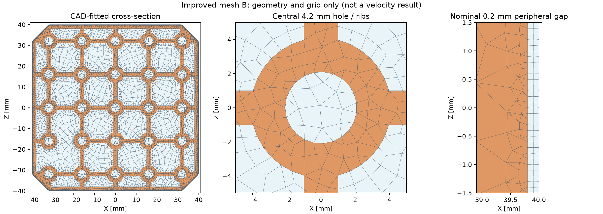
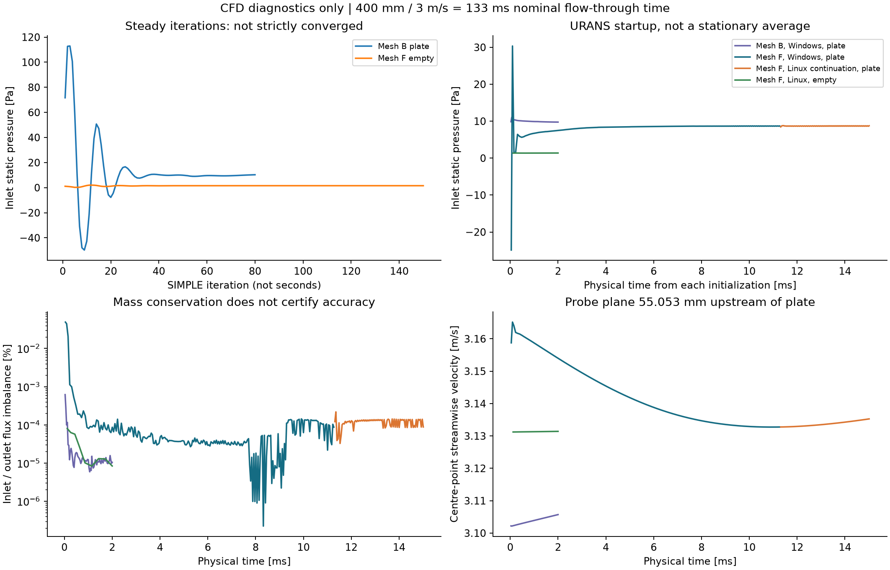
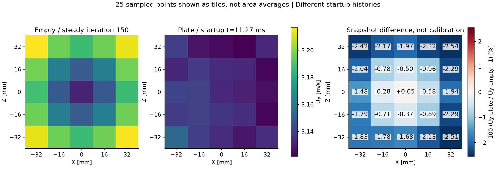
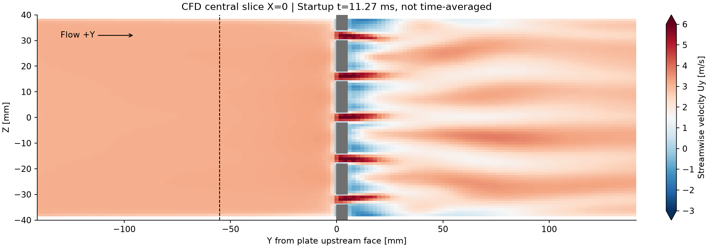

# ピトー管固定板のメッシュ改善と非定常再評価

2026年10月19日。対象は保存済みFusionモデル `merged model v49` の固定板。数値解析による評価であり、センサーやオシロスコープの実測ではない。

[論文形式PDF（2段組み5ページ）](WindTunnel_FixedPlate_CFD_Paper_2026-10-19.pdf)。要旨・方法・結果・考察・結論・参考文献と比較図をまとめた閲覧版です。[PDFの検証記録](results/paper_validation.json)

## 結論

**固定板の形状再現は改善したが、風速への影響率を校正に使える精度では確定できていない。** 固定板は流路投影面積の約34.58%を占めるため、「影響しない位置決め部品」として扱わず、引き続き板の有無を測定条件に含める。

今回、CAD断面に沿う格子へ作り直し、前回の非凸セルを解消した。定常計算に加え、物理時間を進める非定常計算と、公式Linux版OpenFOAMでの読み込み・継続計算も実施した。一方、細長いセルの警告、短い計算時間、空間・時間刻みの依存性が残る。**前回の約8 Paや約±0.32%も、今回の瞬時差分も、補正値には採用しない。**

## 比較したい量と条件

目的は、同じ流量で固定板あり／なしを比較し、約55 mm上流の25点の流速と、必要な入口静圧の変化を評価すること。ファンを同じPWMで回したときの風量低下率とは異なる。

| 条件 | 今回の設定 |
|---|---|
| 流路 | 80 mm角の外接形状、角部を除く面積6,271.168 mm²、一定断面400 mm |
| 固定板 | 板厚5 mm、25個のφ4.2 mm穴と大きな格子開口、周縁の公称隙間0.2 mm |
| 流入 | 一様3 m/s、約67.73 m³/h、乱れ強さ1%、長さスケール5 mm |
| 流体 | 空気密度1.2 kg/m³、動粘性係数1.5×10⁻⁵ m²/s |
| 比較点 | 板前面から55.053 mm上流、x,z各−32、−16、0、16、32 mm |
| モデル | 3次元非圧縮k–ω SST、no-slip壁。定常SIMPLEと非定常PIMPLE |
| 含めないもの | ファン、収縮胴、ディフューザー、ハニカム、プローブ本体、模型、印刷面の粗さ |

比較位置はCADのプローブ先端外形を基準とする。実物の全圧孔・静圧孔の位置を保証しない。板中央断面を5 mm押し出したモデルで、板厚方向5断面の確認では最大0.396 mm²の投影形状差があった。[断面確認値](results/thickness_section_audit.json)

## 格子で改善できた点と残った点

| 指標 | 前回の細かい格子 | 今回の格子F |
|---|---:|---:|
| 板ありセル数 | 510,642 | 1,060,170 |
| 板なしセル数 | 277,714 | 1,127,951 |
| 格子上の閉塞率 | 約35.510% | 34.580163% |
| CAD閉塞率との差 | 約+0.930ポイント | +0.000103ポイント |
| 最大非直交角 | 59.69° | 49.62° |
| 最大skewness | 3.59 | 1.35 |
| 非凸セル | 20,080 | 検査合格 |
| 最大アスペクト比 | 6.91 | 491.01 |
| 小さいdeterminantのセル | 検査合格 | 238,220 |
| 拡張検査の全項目合格 | いいえ | **いいえ** |

面積・閉塞率はCAD断面に近づいたが、これは製作精度や流速精度を保証する数字ではない。格子Fは格子Bと同じ断面配置で、流れ方向の最小幅を0.1 mmから0.5 mm、最大幅を16 mmから12 mmへ変更したもの。初期場もセル番号に沿って伸縮しているため、BとFの差をそのまま格子誤差とはみなさない。

橙色は板、薄青は流路。左右の隙間を10本の線で確認したところ、0.2 mm幅はいずれも2セルだった。旧格子で表現できなかった隙間は流路として残せたものの、十分な解像度の確認には至っていない。また、小穴近傍の代表寸法は約1 mmで、旧局所格子の約0.5 mmより粗い部分がある。セル数の増加を、そのまま全面的な高解像度化とは解釈しない。

細い周縁格子を400 mm全長に押し出す構成が、約100万セルと高いアスペクト比を生んでいる。体積・面・補間重みなどの検査を通過したため診断実行を行ったが、計算結果の精度認定はしていない。[格子監査](results/mesh_audit.json)・[OpenFOAM拡張検査の集計](results/mesh_quality.json)

## 定常と非定常の結果を区別する

左上の横軸は定常計算の反復回数で、秒ではない。他の3図は非定常計算の物理時間。青緑はWindowsで開始した板あり格子F、橙はその保存場からのLinux継続、緑は別の板なし初期場からの試行である。異なる初期状態の曲線を、同じ実験の同時測定とは扱わない。

板あり格子FのWindows試行は0.01127秒まで232ステップを実行した。末尾の入口静圧は8.696 Pa、入口と出口の流量不一致は0.0000869%だった。その保存場からLinuxで約0.01501秒まで継続し、末尾の入口静圧は8.758 Paとなった。板なしLinux試行は0.002秒で1.384 Paだったが、両者は同じ平均期間を持たないため差を確定値として採用しない。

流量保存は改善したが、これだけでは正しい速度分布を得たとは言えない。400 mmを3 m/sで通過する目安は0.133秒であり、今回の試行は初期過渡の範囲にある。各試行の到達時間・末尾値・全場保存時刻は[実行集計](results/run_summary.json)に記録した。

板ありの定常計算だけでなく、板なし基準も厳しい残差目標には未達だった。定常反復の振動を、実流れの渦放出や乱れ強さと解釈してはいけない。非定常解析で得る速度変動も、URANSモデルで解像した成分であり、そのまま実測の乱れ強さにはならない。[NASAの反復収束の解説](https://www.grc.nasa.gov/www/wind/valid/tutorial/iterconv.html)

## 25点の比較はまだ初期場の影響を含む

図は同じ格子F・同じ座標で、板なしの定常150反復と、板ありの非定常0.01127秒を比較した診断用のスナップショット。各タイルは1点の値を見やすく配置したもので、領域平均ではない。

この時点の差は−2.54～+0.05%、入口静圧の差は約7.15 Paだった。**異なる初期履歴・未収束状態の差であり、「板で最大2.54%遅くなる」という確定結果ではない。** 前回の細かい格子では約−0.315～+0.317%だったことも含め、小さい影響率を保証できる段階ではない。初期過渡、格子、数値解法の差を切り分ける必要がある。[25点の元数値と計算式](results/snapshot_comparison.json)

圧力は面積平均入口静圧と出口の基準静圧の差。OpenFOAMの変数pに密度1.2を掛けてPaに換算した。板あり／なしの差は、同じ流量を維持するための入口静圧増分であり、出口の運動エネルギー流束まで考慮した全圧損失とは区別する。ピトー差圧から7.15 Paを差し引く補正は行わない。

灰色は中心縦断面の板またはサンプルのない位置、破線は25点の比較面。板直後に大きな速度むらが現れているが、この図も0.01127秒時点の瞬時場であり、時間平均や渦放出周波数を表すものではない。中心断面は格子の支柱を通るため、正面からの開口率とは見え方が異なる。

## Linux比較環境

公式の [OpenCFD実行用イメージ](https://hub.docker.com/r/opencfd/openfoam-run/tags) `2606` を追加し、格子検査と非定常計算の実行を確認した。イメージのdigestを固定し、解析ケースだけをDドライブから共有、計算中の外部ネットワークは無効にした。既存コンテナーの設定や内容は変更していない。

| 比較項目 | Windows版 | Linux版 |
|---|---|---|
| 実行ファイルのBuild表示 | `34e226dfe3-20211220` | `_481094f-20260618` |
| 両方の表示バージョン | 2606 | 2606 |
| 同一の格子B初期場から最初の6ステップ | 約93秒、到達0.0001852秒 | 約78秒、到達0.0001875秒 |

この小規模比較で大幅な高速化は見られなかった。Build・MPI・適応時間刻みが異なるため、OSだけの性能差とも断定できない。格子FのLinux継続は約0.00374秒を進めるのに約765秒を要した。この速度の単純外挿では0.3秒への到達だけで十数時間程度となり、さらに平均期間と時間刻み比較が必要になる。Linux化だけで格子の精度問題が解消することもない。[実行時間の記録](results/runtime_comparison.json)

Docker起動時には残存した一時ソケットによるエラーがあり、Docker停止後に一時フォルダーだけを改名退避して復旧した。初期化・コンテナー削除は行っていない。環境と再実行方法は[Linux環境メモ](../../../../analysis/plate_cfd_20261019/LINUX_ENVIRONMENT.md)に記載した。

## 次に優先する検証

長時間計算だけを追加する前に、細かい格子を全長へ押し出す構成を見直す。板・壁・周縁隙間の近傍を局所的に細かくし、遠方を粗くする3次元格子へ移す方が、精度と計算量の両方を検証しやすい。現物の0.2 mm隙間が印刷後にも開いているかも確認する。

採用に向けて必要なのは次の検証である。

1. 同じ形状・境界条件で段階的に細かくした格子を比較し、25点速度と必要圧力の変化を確認する。今回のB対Fはその代わりにはならない。[NASAの空間収束の解説](https://www.grc.nasa.gov/www/wind/valid/tutorial/spatconv.html)
2. 板あり／なしの初期過渡を除き、複数の連続した時間窓で平均値が変わらないことを確認する。0.133秒は通過時間の目安であり、これを超えれば自動的に定常統計になるわけではない。物理時間で平均する設定は [OpenFOAMのfieldAverage](https://doc.openfoam.com/2606/tools/post-processing/function-objects/field/fieldAverage/) に従う。
3. 時間刻みを半分にした試行と比較する。最大Courant数2の今回の診断だけで時間離散化誤差を認定しない。
4. 独立支持したプローブで実機の板あり／なしを比較する。同じPWMの比較は風量への影響、同じ基準流速の比較は局所分布への影響として分ける。

当面は、固定板を取り付けた条件のまま校正・運転し、板なしの校正へ自動転用しない。制御ソフトにCFD由来の風速補正値は追加していない。校正と使用時の閉塞条件を合わせる考え方は [NISTの説明](https://www.nist.gov/pml/sensor-science/fluid-metrology/wall-and-blockage-effects-air-speed-calibrations) も参照。

## 保存先

- [解析条件](METHOD.md)、[結果JSON一覧](results)、[図](figures)
- [入力と実行スクリプト](../../../../analysis/plate_cfd_20261019/README.md)、[ケースの採否](../../../../analysis/plate_cfd_20261019/case_selection.json)
- [保存CADと生成格子のハッシュ](results/geometry_provenance.json)
- [成果物の整合性と科学的な採否の検証](results/validation.json)
- [前回の予備評価](../2026-10-18_fixed_plate/REPORT.md)

前回の比較データ、試行の入力・ログ、選択格子、主要全場は追跡・再計算用に保持した。PDF化後、不採用格子A/Cの生成済み3D格子、A/C/Dの生成済み断面格子、格子Fの未採用中間平均場だけを削除した。計710ファイル、3,164,027,814 bytes（約3.16 GB、2.95 GiB）。削除一覧・SHA-256・理由は[整理記録](results/cleanup_manifest.json)に保存した。削除ファイルのバックアップはなく、必要時は残した生成コード・条件から再生成・再計算する。中間平均場は結果に採用していない。初期場、完全なチェックポイント、点時系列、採否メタデータは残した。Fusion原本と実機の配線・制御設定は変更していない。

Linuxの板あり最終時刻は、終了時刻を短縮した後の全場保存周期に届かず、ログ・25点速度・流量・入口静圧の記録のみが残る。上記の縦断面図と再開用の全場はWindowsの0.01127秒を使用した。生成スクリプトは短い試行の保存間隔を終了時刻に合わせるよう修正したが、この修正で過去の最終3D場が復元されたわけではない。
