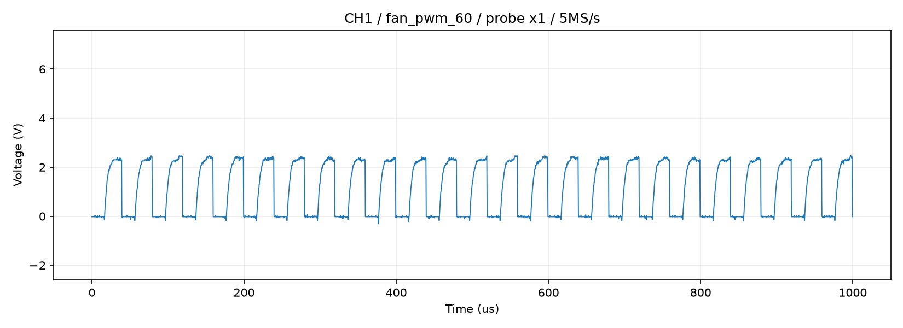

# ファン側PWM線の測定結果

2026-09-07 21:41–21:43 JST。ユーザーが正常確認済みのCH1プローブをファンPWM線へ移したと報告後に実施。倍率×1、GNDは共通GNDの継続と解釈。測定点はファン4番PWM／C1815コレクタの想定。プローブの型番・入力容量と現物の配線／抵抗値は未確認。

## 条件

OWON Python USB API、CH1 DC、10 Vフルレンジ、offset=0.25、5 MS/s、5000サンプル（1 ms）×各3回。PWMの周期40 usあたり約200サンプル。Pi sysfsはperiod=40000 ns、enable=1。停止指令duty=40000、中間60%指令duty=16000、最大100%指令duty=0。これはC1815による反転を前提としたファン指令で、sysfs側のHigh比率はそれぞれ100%、40%、0%。

各回転条件はPi上のPythonで設定し、3秒待機後25秒の取得窓を設け、finallyで停止指令に戻した。READY時のdutyを読み戻し確認した。

## 結果

| ファン指令 | 波形 | 電圧 | 周波数／High比率 |
|---|---|---|---|
| 停止 | Low固定 | 平均約−0.02 V | High 0% |
| 60% | 立上りが丸い周期波形 | Low約0 V、High約2.30～2.34 V | 約25 kHz、Schmitt閾値1/2 VによるHigh約39.3～40.1% |
| 100% | High固定 | 平均約2.34～2.37 V | High 100% |
| 終了停止 | Low固定 | 平均約−0.02 V | High 0% |

60%時の内蔵周波数カウンタは25000.125 Hz。サンプルの周期中央値による値は25000～25062.7 Hzで、ノイズや閾値通過時刻の変動を含む。最大指令時の取得内電圧範囲は約2.14～2.58 V。ADC飽和は全取得で0%。電圧は独立校正済みの測定ではない。

## デューティ値の解釈

60%指令を単純に「実際40%だった」と断定してはいけない。立上りが丸いため閾値で数値が変わる。同じ保存波形の閾値超過時間割合は次のとおり。

| 閾値 | 3回の時間割合 |
|---|---|
| 0.8 V | 51.88～52.36% |
| 1.16 V（振幅のおおむね中間） | 49.30～49.64% |
| 1.5 V | 46.18～46.50% |
| 2.0 V | 39.14～39.88% |
| 2.1 V | 34.76～36.40% |

以上は解析上の閾値で、ファン内部の実際のHigh判定閾値を確認したものではない。波形から上昇の遅れが確認できる。C1815の動作／接続、プルアップ、配線や×1プローブの容量負荷などが候補になるが、今回の測定だけでは原因を分離できない。部品や抵抗値の変更はしていない。

## メーカー資料との照合

[ARCTIC P14 Pro PST公式マニュアル](https://support.arctic.de/p14-pro-pst/)（2026-09-07参照）にはPWM目標25 kHz、動作範囲21～28 kHz、Low最大0.8 V、開放電圧の絶対最大5.25 V、短絡電流の絶対最大5 mAが記載されている。今回の周波数とLowはこの記述と整合する。

同ページには最低High電圧が記載されていないので、測定された約2.35 Vだけで規格外とは断定しない。また5.25 Vは絶対最大値であり、必ず5 Vが出るべきという意味ではない。

## 結論と次の測定

停止Low／最大Highへの変化と約25 kHzの周期波形を実測し、ファン側へ制御が伝わることは確認した。中間指令の波形が鈍る問題は残る。以前のTach測定で60%と100%の周波数がほぼ同じだった原因は未確定で、PWM波形だけで説明がついたとは言えない。

次は同じ測定点で、プローブを物理×10へ切り替え、ソフトも×10として再測定する比較が有用。波形が改善すれば測定負荷の影響が疑われる。併せて、ファン2番と1番の間の運転中電圧を測定する。いずれもプローブ設定／接続の変更をユーザーが行ってから測る。PWM Highの外部プルアップ追加や回路の変更を現時点で決めない。

## 終了状態

sysfs duty=40000、enable=1を確認。ファンPWM端子もLow固定へ戻ったことをオシロで確認。Pi GPIO17は3秒間両エッジ0、入力Lowであり、停止状態と整合。USBとイベント監視は解放。ファームウェアや常駐設定は変更していない。

データフォルダー:

- tach_retest_20260907_214125_fan_pwm_stop
- tach_retest_20260907_214154_fan_pwm_60
- tach_retest_20260907_214240_fan_pwm_100
- tach_retest_20260907_214319_fan_pwm_final_stop

