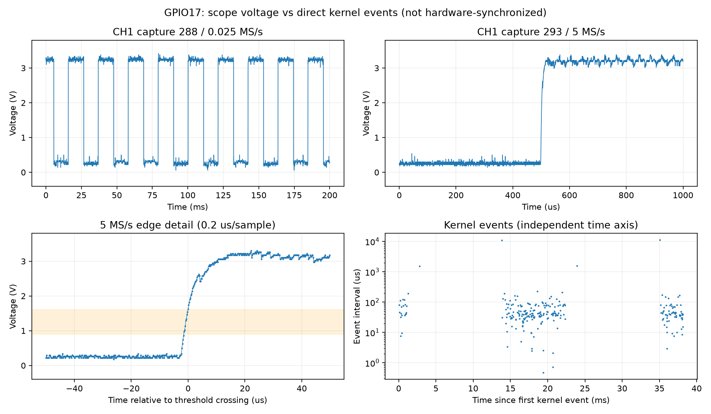

# GPIO17 カーネルイベント・高時間分解能波形 比較結果

実施日: 2026-09-07 22:29–22:36 JST

## 結論

GPIO17の異常な多重カウントは、従来のRPi.GPIO互換コールバックを通さない **libgpiodによる直接取得でも再現した**。従来のPythonコールバック処理だけが原因、という説明では足りない。

5 MS/sの電圧記録では、0.9 V / 1.6 Vのヒステリシス判定で、1 ms内の複数の立ち上がりは確認できなかった。ただし、断続的なトリガ波形記録であり、Piとオシロに共通のハードウェア時刻もない。**電気的ノイズを完全に否定した結果ではなく、GPIO回路の故障やカーネルの不具合を確定した結果でもない。**

GPIO17は維持した。回転数フィードバックの問題は未解決で、今回の異常イベントをRPMへ換算して制御に使ってはいけない。

## 実機と条件

- 実機のデバイスツリー: **Raspberry Pi 3 Model B Plus Rev 1.3**。当初の申告の3 Model Bではなく、実機は3B+と識別された。
- OSカーネル: `6.18.34+rpt-rpi-v8`、aarch64。
- 従来の `RPi.GPIO` の実体: `python3-rpi-lgpio 0.6` / `lgpio 0.2.2`。互換APIの `VERSION=0.7.2` を元のRPi.GPIO実装の版と解釈しない。
- 今回: インストール済み `gpiod 2.2.0`、`/dev/gpiochip0`、line 17、BCM番号。物理ピン11。
- 入力、極性反転なし、バイアス変更なし、デバウンスなし。イベント時刻はカーネルのMONOTONIC時刻。ユーザー空間で読んだ時刻も別列に保存。
- ファン: 12 V接続の申告に基づく。今回は電源電圧を独立に再測定していない。
- PWM: 25 kHz、C1815反転回路、指令60%時のPi側dutyは16,000 ns。停止指令は40,000 ns、enable=1。
- オシロ: OWON VDS1022I、CH1、GPIO17上のTach、×1、DC、10 Vレンジ、1.5 V立ち上がりトリガ、AUTO。
- 波形: 25 kS/s × 5,000点 = 200 ms、および5 MS/s × 5,000点 = 1 ms。後者のサンプル間隔は0.2 µs。

## 直接取得の結果

全て保存したイベント列内の連番欠落は0。連番が飛んでいないことは、GPIOの電気入力に余分なエッジがないことを保証するものではない。

| 試験開始 JST | 指令 / エッジ | 取得時間 | 保存イベント数 | 結果 |
|---|---|---:|---:|---|
| 22:29:12 | 60% / 立ち上がり | 38.96 ms | 立上251 | 上限停止 |
| 22:30:54 | 60% / 立ち上がり再試験 | 39.41 ms | 立上251 | 上限停止 |
| 22:32:57 | 60% / 両エッジ | 19.95 ms | 立上0、立下251 | 上限停止 |
| 22:35:18 | 停止 / 両エッジ | 3.001 s | 0 | 正常終了 |
| 22:35:34 | 60% / 立ち上がり、5 MS/s専用記録 | 53.71 ms | 立上251 | 上限停止 |

回転試験は20秒の待機後にイベントを取得した。停止上限は「カーネル時刻の50 ms以内に250件を超える」または総数12,000件、実行時間上限も設定。最後の53.71 msには最初の待ち時間と後処理を含むため、50 msを超えるが、判定対象はイベントの移動時間窓である。

22:30:54の再試験では、立ち上がりイベント間隔の中央値41.46 µs、最小0.469 µs。オシロのTach周期約21.1 msとは整合しない。これは回転数ではない。

### GPIO検出レジスタの読み取り

`/dev/gpiomem`を読み取り専用で参照した。レジスタへの書き込みはしていない。

- 停止・両エッジ取得中: GPIO17のREN/FENのみ有効、HEN/LEN/AREN/AFENは無効。
- 最終60%・立ち上がり取得中: RENのみ有効、FEN/HEN/LEN/AREN/AFENは無効。
- 取得解放後: 上記の検出ビットは全て無効。

少なくともこの読み取り時点では、立ち上がり検出のつもりでHighレベル検出が有効になっていた、という設定異常は確認されなかった。入力パッドのヒステリシス設定は今回未読である。

## オシロとの比較

| 試験 | 保存した全波形記録 | Low/High遷移を含む5 MS/s記録 | 1 ms内の複数立ち上がり |
|---|---:|---:|---:|
| 22:30:54 立ち上がり再試験 | 457 | 149 | 0 |
| 22:32:57 両エッジ試験 | 511 | 147 | 0 |
| 22:35:34 5 MS/s専用試験 | 3,030 | 659 | 0 |

ここでの本数は取得レコード数であり、独立した全パルスを漏れなく観測した数ではない。AUTOトリガとUSB転送のため取得間に未観測区間がある。

- 再試験の取得直前の200 ms波形: **47.348 Hz**、約**1,420 rpm**（2パルス/回転を仮定）。Lowの代表値0.26 V、High 3.22 V。
- 両エッジ試験の取得直前: **47.710 Hz**、約**1,431 rpm**（同仮定）。
- 再試験の代表5 MS/s波形: 10–90%立ち上がり時間は約**10.6 µs**。これは×1プローブ接続時の観測値であり、プローブ負荷を除いた値ではない。閾値付近に緩やかな遷移はあるが、同じ1 ms波形内でLow/Highを何度も往復する波形は見えていない。
- 最後の試験では、カーネル取得の時刻窓とUSB取得呼び出しの時刻窓が重なる5 MS/s記録が3件（index 1707, 1708, 1709）あった。各記録は1 ms、立ち上がり1回、クリッピング0。
- **USB取得呼び出しの開始・終了時刻は、実際の波形サンプルの絶対時刻ではない。** 両装置のクロックも相互校正していないため、特定のカーネルイベントと電圧波形の1対1対応を確定していない。

## 次に絞り込む項目

1. **入力パッドのヒステリシス設定の読み取り確認**。今回はエッジ検出レジスタまで確認したが、パッド設定は未確認。
2. **既知の3.3 V矩形波をGPIO17へ入力する対照試験**。ファンのTachをGPIO17から外し、独立した既知の低周波信号を入力して同じ直接取得を行う。回路・配線作業が必要で今回は未実施。GPIO17へ5 V / 12 Vを入力しない。既存GPIO18はファン駆動に使うため、そのまま流用しない。
3. 対照試験でも異常なら、GPIOの入力回路・カーネル/ドライバ側を優先する。対照試験が正常でTach接続時だけ異常なら、Tach配線・プルアップ・入力波形整形・接地を優先する。どちらの結果だけでも故障箇所を直ちに断定しない。

ライブラリ変更、デバウンス導入、カーネル更新、GPIOピン変更などの恒久対策はまだ実装していない。

## 終了時の状態

- GPIO17: input、内部pullなし、Low。
- PWM duty: 40,000 ns、enable=1。ファン停止指令へ復帰。
- 最終オシロ記録: Low約0.2–0.4 V、遷移なし。
- `vcgencmd get_throttled`: `0x0`。
- 新しいサービスやパッケージは追加していない。Piの`/tmp`に一時診断スクリプトと測定データを保存した。

## 保存物

カーネルの原データは次の各フォルダーの`events.csv`、`summary.json`。

- `windtunnel_kernel_20260907_222912_60_rising`
- `windtunnel_kernel_20260907_223054_60_rising`
- `windtunnel_kernel_20260907_223257_60_both`
- `windtunnel_kernel_20260907_223518_0_both`
- `windtunnel_kernel_20260907_223534_60_rising`

波形原データは次の各フォルダーの`waveforms.npz`、取得条件は`summary.json`、解析は`analysis.json`。`checkpoint_*.npz`は途中保存分。

- `kernel_scope_20260907_223044_gpio17_direct_60_rising_repeat`
- `kernel_scope_20260907_223247_gpio17_direct_60_both`
- `kernel_scope_20260907_223523_gpio17_direct_60_fastonly`

初回22:29のオシロ取得は途中終了したため永続保存がなく、上表の波形評価には使っていない。初回のカーネルイベント原データは保存済み。

診断コード: `hardware/kernel_tach_diagnostic.py`、`hardware/capture_tach_multirate.py`、`hardware/analyze_kernel_scope.py`。

## 仕様の参照

- カーネルのイベント時刻、連番、バッファ欠落の解釈: [Linux GPIO v2 line-event read](https://docs.kernel.org/userspace-api/gpio/gpio-v2-line-event-read.html)。イベント時刻はPythonのコールバック実行時刻と区別する。
- BCM2837系の入力電圧仕様: [Raspberry Pi公式 Voltage specifications](https://www.raspberrypi.com/documentation/computers/raspberry-pi.html#voltage-specifications)。Low保証最大0.9 V、High保証最小1.6 V（ヒステリシス有効時）。解析の閾値は実際の個体のスイッチング閾値を測った値ではない。
