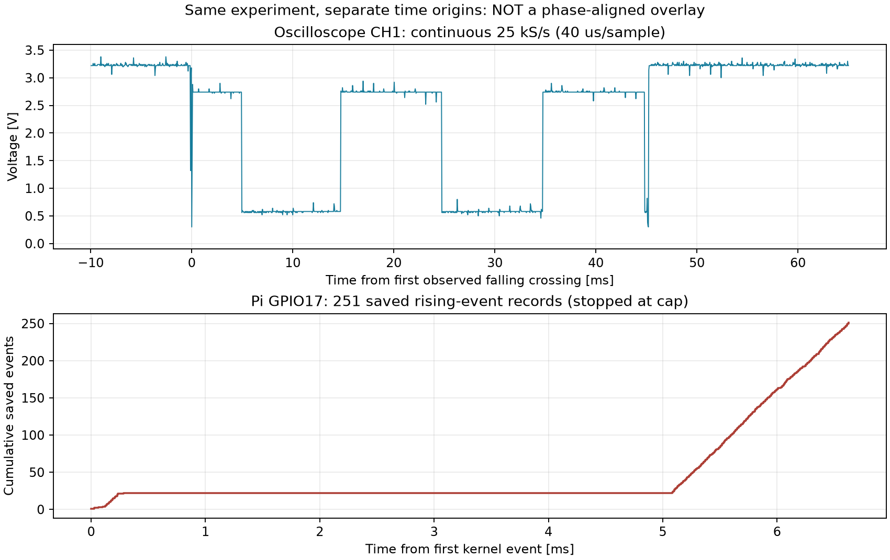

# GPIO17：50 Hz入力の同時取得結果

2026-09-08 19:31 JST。現配線・短時間測定の既存許可に基づく。保存先：`simultaneous_20260908_193102/`。正式PDFは全測定後に作成する。

## 結論

**入力ヒステリシス有効でも、GPIO17のカーネル割り込みそのものが大量に発生した。Pythonの保存・集計だけの問題では説明できない。** ただし入力パッド、短時間の電圧変動、ドライバ／カーネルのどこが原因かは未確定。

今回、発振器ON前からOFF後まで連続するオシロ記録が得られた。前回の「オシロ取得後にPi取得」という非重複は解消した。しかし40 µs/標本のため、µs以下のエッジやチャタリングを否定する試験ではない。

## 安全判定の見直しと条件

ユーザーの最新テスター値はGPIO17対GND **3.242 V**（発振器OFF）。直前のオシロ中央値約3.22 Vと整合する。これは直流値の確認であり、瞬間的な過電圧を否定する証拠ではない。

前試行の「全標本3.3 V以下」は、公称電源電圧と測定ばらつきを区別しない保守的な中断条件だった。OFF時に通常／連続両取得で2.98〜3.44 Vの記録があり、今回はOFF中央値がテスター値±0.10 V以内かを確認したうえで、測定標本の監視範囲を−0.3〜3.5 Vとし、クリッピング検出を維持した。この範囲は**GPIOの許容入力定格ではない**。信号源は前回確認済みの2.4 Vpp／+1.5 V設定を変更せず、最大約1秒に制限した。

- 接続前提：WF1974 CH1主出力→R3 1 kΩ→GPIO17、R4 10 kΩ→3.3 V、信号GND共通、ファンTach切離し、オシロCH1先端GPIO17。現物の独立写真検査はなし。
- WF1974：50 Hz矩形波、2.4 Vpp、offset +1.5 V、duty50%、High-Z、独立、連続、加算OFFを読出し確認。変更はCH1出力ON／OFFのみ。
- Pi：3B+、6.18.34+rpt-rpi-v8、gpiod 2.2.0。GPIO17入力、立上りのみ、Bias.AS_IS、デバウンス0。GPIO18は停止要求Highのまま。
- PADS GPIO0〜27は再読出し0x1B、ヒステリシス有効。パッド／内部プル／起動設定の変更なし。

## 取得結果：出所を区別

| 出所 | 結果 | 注意 |
|---|---|---|
| Piイベント列 | 251件で上限中断、連番欠落0 | 正常終了の回転数測定ではない |
| Piイベント時刻 | 最初〜最後6.624275 ms、隣接間隔中央値6.718 µs | 取得開始からの経過時間とは別 |
| Pi取得窓 | 開始〜中断処理330.215839 ms、最初のイベントは開始319.037170 ms後 | 最初の約0.3秒はOFF待機 |
| `/proc/interrupts` GPIO17子IRQ | 増分2,094回：CPU0=545、CPU1=549、CPU2=509、CPU3=491 | 保存251件とは締切が完全に同じではない |
| オシロCH1 | 25 kS/s、35,316標本、1.41264秒、48連続ブロック | サンプルオフセットの連続性検証済み、欠落検出エラーなし |
| オシロ信号部 | Low中央値0.58 V、High中央値2.74 V、活動区間0.30〜2.94 V | 出力切替も含む短い記録 |
| 出力ON→最初のOFFコマンド | 43.5215 ms | 機器の実際の切替時刻そのものではない |
| OFF前／後のPi | 各約3秒、イベント0件 | 回復確認も正常 |

子IRQの増分は、GPIO要求中の開始前と、中断時に要求を解放する前の/proc/interruptsを比較した。イベント上限到達後もスナップショット中は割り込みが継続し得る。またハードIRQとスレッド化されたイベント生成は1対1とは限らない。**2,094−251をイベント取りこぼし数として扱ってはならない。** いずれにしてもIRQそのものの過剰増加を確認した点が今回の進展である。

## 波形上の遷移と時間比較の限界

1 V以下をLow、2 V以上をHighとする解析で、オシロ全体に立上り4回／立下り4回を検出。出力ON／OFF時の遷移を含むため、これを50 Hzの周期エッジ4回と解釈しない。

最初の立下りを0 msとした遷移：

- 0.00 ms立下り、0.08 ms立上り：切替付近の約80 µs Low区間。
- 4.96 ms立下り、14.76 ms立上り、24.76 ms立下り、34.76 ms立上り：中央の立上り間隔は20.00 ms。
- 44.84 ms立下り、45.24 ms立上り：OFF切替付近の約400 µs Low区間。

切替に短いパルスがあることは新たな観測だが、それだけで251イベント／2,094 IRQを説明したわけではない。標本間の短い電圧変動は未評価。

PCとPiの時計を高精度に同期していないため、イベントと個別波形エッジのµs単位対応は未確定。比較図は上段をオシロ最初の立下り、下段をPi最初のイベントという**独立した時間原点**で表示する。横軸を揃えた重ね合わせや、特定のLow区間で発生したという断定はしない。

## 次の検査候補（今回未実施）

1. GPIO17の配線を維持して、短い窓をより高いサンプリング速度で取得する。ON切替時と定常エッジを分ける。連続25 kS/sと高速単発取得は時間範囲・分解能が異なるため相互補完として扱う。
2. GPIO17子IRQの設定・割当・実行カーネル対応ソースを確認する。入力ヒステリシス無効の仮説は優先度を下げ、入力波形とIRQ処理の双方を残す。
3. 入力信号の健全性を確認した後、必要なら予備SD上の別カーネルで比較する。現OSの更新／書換えやIRQ affinity変更は実施していない。

## 終了状態

WF1974 CH1／CH2ともOFFを読出し確認。GPIO17は入力High、GPIO18は出力High。配線変更・ファン実回転・恒久設定変更なし。`run_log.json`のcompletedは測定シーケンスとOFF回復が完了した意味であり、計数正常を意味しない。ON計数結果は明示的にaborted。
