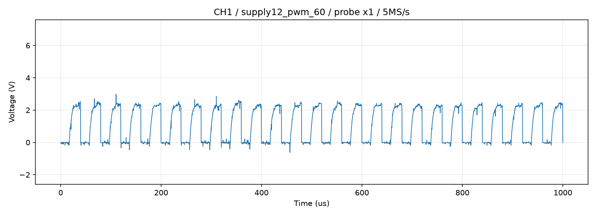
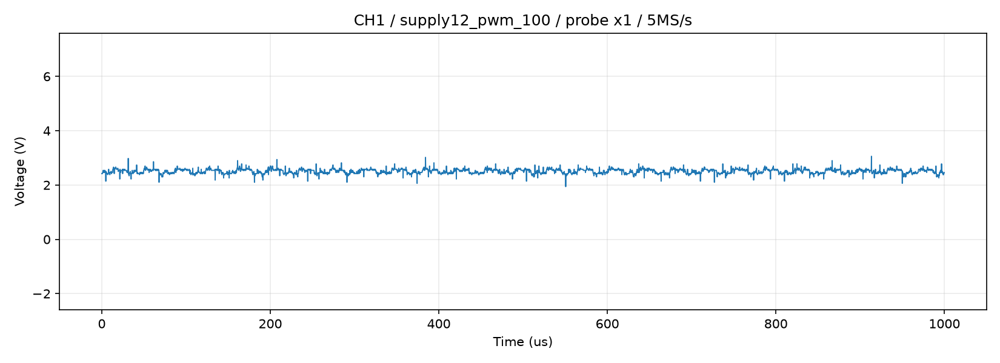

# 12 V接続後のファン再試験

実施日：2026-09-07、約21:58～22:02 JST。

## 前提と結論

ユーザーが先行検査で5 Vを確認し、その後12 Vへ接続したと報告したため再試験した。電源電圧そのものは本試験のオシロでは測定していない。12 Vはユーザーの接続報告に基づく条件名であり、運転中の端子間電圧の独立確認値ではない。

PiのTach計数は60%指令で約43.37 Hz、100%指令で約81.57 Hzとなり、指令に対する明確な増速を確認した。2パルス/回転を仮定すると約1,301 rpmと約2,447 rpm。以前の最大指令時約1,250～1,306 rpmに対して最大時の値が大幅に増加しており、5 V給電が最大回転数を制限していたことを強く支持する。ただし光学回転計での校正は未実施。

## 条件

- Raspberry Pi 3 Model B、BCM18で反転PWM、BCM17でTach入力。
- PWM sysfs：period=40000 ns、enable=1。ファン指令0/60/100%に対しduty_cycle=40000/16000/0 ns。各READY時に読み戻し確認。
- 停止→60%→100%→停止。回転条件は20秒待機後40秒間の立ち上がり計数、停止条件は3秒待機後3秒計数。
- RPi.GPIO、BCM17入力、内部プルアップ追加指定なし、デバウンス指定なし。イベント時刻はコールバック内time.monotonic_ns()で記録し、ハードウェア時刻ではない。
- Piのfinally処理でduty_cycle=40000、enable=1へ戻し、イベント監視を解除。
- OWON VDS1022I CH1は前回と同じファンPWM線に接続されている前提。DC、×1、10 Vフルレンジ、offset=0.25、5 MS/s、5000点=1 ms、各条件3回。今回はTachのオシロ波形は取得していない。

## PiのTach計数結果

| 指令 | 取得秒数 | 立上り数 | 周波数 Hz | 2 PPR換算 rpm | 周期中央値 ms | 最小周期 ms | 最大周期 ms |
|---|---:|---:|---:|---:|---:|---:|---:|
| 停止 | 3.00097525000092 | 0 | 0 | 0 | - | - | - |
| 60% | 40.001263176000066 | 1735 | 43.37363028677965 | 1301.2089086033895 | 23.096379 | 10.877802 | 23.799135 |
| 100% | 40.00135868300276 | 3263 | 81.5722292299662 | 2447.1668768989857 | 12.2620915 | 5.888665 | 12.559303 |
| 終了停止 | 3.0012468519998947 | 0 | 0 | 0 | - | - | - |

回転中の最小周期は中央値の約半分であり、計数に余分なエッジやソフトウェア時刻の影響が含まれる可能性は残る。今回の回転数はPi計数に基づく参考値であり、オシロによるTach周期の照合は別途必要。停止条件はいずれもGPIO17入力Low。

## ファン側PWM

| 条件 | 電圧・波形 | 周波数・解析結果 |
|---|---|---|
| 開始停止 | 平均約-0.017～-0.019 V、Low固定 | 周期なし、High時間0% |
| 60% | Low約-0.02 V、High（90パーセンタイル）約2.30～2.38 V、立上りに遅れ | 波形周期から24.938～25.126 kHz。1/2 Vヒステリシス判定のHigh時間39.10～39.94% |
| 100% | 平均2.459～2.502 V、周期的なLowへの切替なし | 1/2 Vヒステリシス判定High時間100%、周波数算出対象外 |
| 終了停止 | 平均約-0.019 V、Low固定 | 周期なし、High時間0% |

全取得でADC飽和0%。微小負電圧は測定オフセット／雑音を含み、負電源を意味しない。電圧は独立校正済みではない。

60%のオシロ内蔵周波数値は約27.366 kHzで、保存波形の約25 kHzと不一致だった。保存波形には約40 μs周期、1 msあたり約25周期があるため、本試験のPWM周波数は波形周期から評価し、内蔵カウンタ値を採用しない。不一致の原因は未特定。

100%波形は細かい変動があり、取得内最小1.90～1.94 V、最大2.90～3.06 V。スクリプトの固定High判定は全サンプルが2 V超であることを要求するためlevel_state=switching_or_uncertainとなるが、1 V以下への切替はなく、周期的PWMが残っていることを意味しない。rejection_reasonの周期不足は周波数算出に関するもので、今回の連続High確認の失敗ではない。

60%指令を「実際40%」と断定しない。立上りの遅れで閾値によりHigh時間割合が変わり、ファン内部のHigh判定閾値は未確認。この波形上の課題は12 V接続後も残っている。

## 終了確認と次の検査

- 最終読み戻し：period=40000 ns、duty_cycle=40000 ns、enable=1。
- Pi Tach：3秒間立ち上がり0回、GPIO17 Low。
- ファン側PWM：Low固定をオシロで確認。
- Pi get_throttled：開始時・終了時とも0x0。ただしファン電源12 Vの保証ではない。
- USB測定を終了済み。ファームウェア、永続起動設定、回路部品値は変更していない。

次はGPIO17のTachをオシロで再測定し、Piの約43.4/81.6 Hzと照合する。先端の移動は停止・電源OFFで行う。運転中のファン端子1–2間電圧をテスターで確認し、必要に応じ中間指令のPWM立上りと実装を調査する。最大回転数が改善したため、根拠なく回転換算係数やプルアップ抵抗を変更しない。

## 保存波形

- 開始停止：tach_retest_20260907_215851_supply12_pwm_stop
- 60%：tach_retest_20260907_220008_supply12_pwm_60
- 100%：tach_retest_20260907_220110_supply12_pwm_100
- 終了停止：tach_retest_20260907_220203_supply12_pwm_final_stop

各フォルダーにcapture_0～2.csv、summary.json、waveform.png。Pi集計値はSSH標準出力から上記表へ転記し、個々のTachイベント時刻は保存していない。

