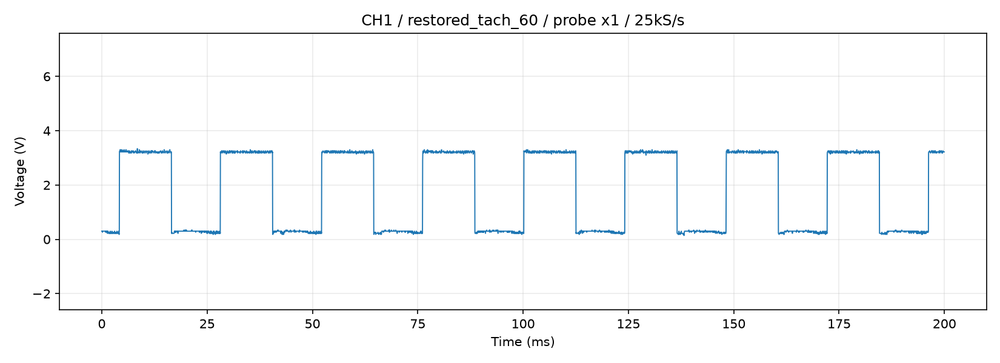

# 配線復旧・正常プローブによるTach測定結果

実施: 2026-09-07 21:33–21:35 JST。ユーザーから配線を復旧しGPIO17へプローブを接続したと報告後に実施。正常な短絡測定ができたプローブをCH1へ接続、倍率×1、先端はBCM17（物理11番）の想定、GNDはPi共通GND。現物の抵抗値とファン端子電圧はこの試験では未確認。

## 結果

**回転中の明瞭なTach矩形波、および停止後のパルス消失を確認した。** 以前の大きなノイズ状取得は今回再現しない。プローブ交換と接続復旧後に改善しているが、旧プローブ内部の故障箇所まで特定したわけではない。

| ファン指令 | オシロの周期から求めた周波数 | 換算RPM（2ppr仮定） | Piの立上り計数 |
|---|---|---|---|
| 停止 | パルスなし | パルス計測上0 | 最終停止確認で両エッジ0回/3秒 |
| 60% | 41.632～41.667 Hz | 1248.96～1250.00 | 1030回/25.00024秒、41.19961 Hz、1235.99 rpm |
| 100% | 41.597～41.632 Hz | 1247.92～1248.96 | 1088回/25.00024秒、43.51959 Hz、1305.59 rpm |

安定したフレームのLowは約0.22～0.26 V、Highは約3.22 V。60%の最初のフレームのHighは約3.10 V。取得内の最大約3.34 V、ADC飽和なし。Low/Highは10/90パーセンタイルであり、校正済みの絶対精度を保証する値ではない。

オシロはCH1 DC、10 Vフルレンジ、offset=0.25、25 kS/s、5000サンプル（0.2秒）×各条件3回。1 V/2 Vのヒステリシス閾値で立上りを検出し、周期中央値から周波数を算出。オシロ内蔵周波数カウンタも60%で41.630～41.666 Hz、100%で41.589～41.601 Hzと整合した。

PiはRPi.GPIOの立上りイベントをデバウンス指定なしで計数。GPIO17は入力設定、内部プルアップを追加指定しない。60%では15秒、100%では20秒の待機後、25秒の計数窓内にオシロ取得を実施した。Piのエッジ間隔中央値は60%で24.0888 ms、100%で24.0194 ms。オシロとPiは同時刻帯だが同じ長さの窓ではない。

## 未解決事項

1. **60%から100%へ指令を上げても、オシロで確認するTach周波数がほぼ変わらない。** GPIO18のsysfsへの書込みは行ったが、ファンPWM端子の実波形と運転中12 Vをまだ確認していない。PWM伝達、供給電圧、ファン側の特性などを切り分ける必要がある。
2. **Piの計数とオシロは完全一致していない。** 60%のPiは約1.1%低く、100%のPiは約4.6%高い。窓の違い、回転変動、余分なエッジ、取りこぼしなどを区別できていない。短いオシロ窓が安定していることだけで25秒全体の挙動を保証しない。
3. 2パルス/回転を仮定したRPMであり、独立した光学回転計などで回転数そのものを校正したわけではない。公称値へ合わせるために換算係数を変更しない。

## 終了と次の確認

各回転試験はPi上のtry/finallyで最大25秒の計測後にduty=40000へ戻す処理を実行した。最終値はperiod=40000 ns、duty_cycle=40000 ns、enable=1。最終停止後、Piで3秒間の両エッジ0、入力Low、オシロでもパルスなし・約0.25 Vの一定電圧を確認。イベント監視とUSB取得を終了済み。再起動時の停止を保証する設定変更は行っていない。

次は正常プローブでファン4番PWM端子（C1815コレクタ）を測り、25 kHzと指令に応じたデューティが届いているか確認する。併せてファン1–2番間の運転中電圧を測る。現時点ではプローブはGPIO17接続のままなので、PWM測定にはユーザーによる先端の移動が必要。

## 保存波形

- 開始停止: tach_retest_20260907_213321_restored_tach_stopped
- 60%: tach_retest_20260907_213408_restored_tach_60
- 100%: tach_retest_20260907_213509_restored_tach_100
- 最終停止: tach_retest_20260907_213547_restored_tach_final_stop

各フォルダーに3回分の生CSV、数値JSON、波形PNGを保存。ゼロパルス時のvalid_tach=falseは周波数を算出する周期がないことを示し、今回の停止確認の失敗を意味しない。
