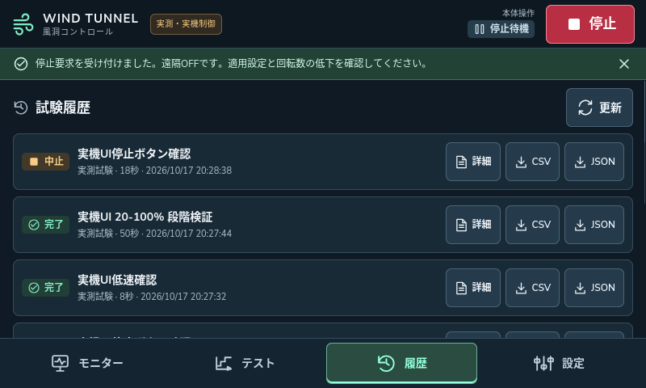
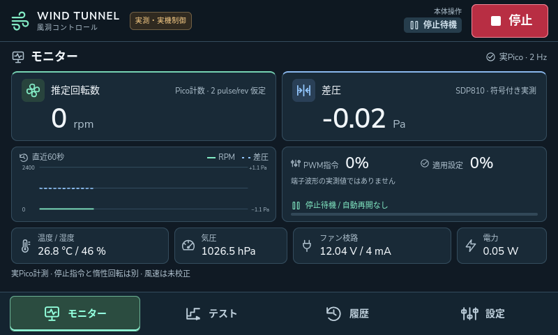

# Pico回転数取得とUIファン制御

2026年10月17日 / アプリ0.3.0 / Pico FW 0.3.0-control / Carrier Rev E

Raspberry Pi本体の画面から実ファンの有限PWM試験を開始・停止できる。Picoが回転パルスをハードウェア計数し、差圧・温湿度・気圧・電圧・電流・電力とともにUSBで送る。低速運転、20～100%段階運転、停止ボタンによる中止を実機で検証した。最終状態はPWM 0、Tach 0 rpm、遠隔OFFである。

これはPWM設定と回転数計測の実装であり、目標RPMへ自動調節する閉ループ制御ではない。RPMは2 pulse/rev仮定。差圧の配管対応と校正が未確定なため、風速は表示しない。

## 画面から試験する

1. ファン周囲に接触物がないことを確認し、12 V電源とSW1をONにする。画面の電圧が約12 V、回転数が0へ下がっていることを確認する。
2. 上部が「実測・実機制御」、センサーが正常、遠隔モードがOFFであることを確認する。
3. 「テスト」でPWM・整定待ち・収録時間を入力する。初回は20%の単一段階で確認する。
4. 「条件確認」から実機ファンが回転する旨を確認して開始する。「開始確認中」から「試験中」へ移る。
5. 終了時は「停止応答待ち」を経て完了する。途中で止める場合は右上の「停止」を押す。Tachの惰性回転が0へ下がるまで待つ。
6. 「履歴」で完了・中止・異常理由を確認し、CSVまたはJSONを保存する。

実機プリセットは20→40→60→80→100%、各4秒待ち＋6秒収録、計50秒。設定上限は12段階、5回繰返し、合計300秒以内、PWM 0または20～100%。整定待ち時間が過ぎても定常状態を保証しない。

応答が途絶えた場合、画面だけで物理停止を断定しない。SW1をOFFにしてファン枝路を遮断する。画面の停止は安全認証された非常停止ではない。

## 実機の測定結果

最終段階試験は2026年10月17日20:27:44～20:28:35 JSTに実行した。保存102サンプルはすべて有効で、取得seqの欠落0・重複0だった。下表は各段階の収録区間12サンプルから求めた値である。

| PWM | 推定RPM | 平均電流 mA | 平均電圧 V | 符号付き差圧 Pa |
|---:|---:|---:|---:|---:|
| 20% | 569 | 20.5 | 12.037 | −0.97 |
| 40% | 919 | 46.9 | 12.032 | −2.75 |
| 60% | 1433 | 107.3 | 12.021 | −7.00 |
| 80% | 1890 | 199.7 | 12.003 | −12.54 |
| 100% | 2296 | 332.3 | 11.979 | −19.05 |

RPMは `30 × 合計エッジ数 ÷ 合計計数時間秒`、電流・電圧・差圧はサンプル平均。`phase=record`、valid、計数窓内のPWM変更なしを選別した。負差圧を絶対値に置換していない。値はこの装置・今回の短時間運転の結果であり、ファンの定格値や独立校正値ではない。

証跡：[集計JSON](measurement-summary.json)、[段階試験JSON](3a14397e-d762-4e37-9c33-6d7735807def.json)、[CSV](3a14397e-d762-4e37-9c33-6d7735807def.csv)。初回試験で二つの2 Hzタイマーの位相ずれによる保存欠落を検出したため、Piの記録を取得seq基準へ変更した。初回データは検証履歴として残し、表は修正版の再試験から作成している。

## PicoとPiの役割

| 担当 | 実装 |
|---|---|
| Pico GP15 | PWM slice 7 Bの立下りエッジ計数。出力を強制無効化した入力専用設定 |
| Pico GP16 | 25 kHz PWM設定。停止時はPWMを解除してLOW |
| Picoセンサー | 約0.5秒周期でSDP810・BME280・INA260とTachを取得 |
| Pi USBワーカー | 排他シリアル、約250 ms周期の通信。API要求処理ではUSB応答待ちをしない |
| Pi試験管理 | 約50 ms周期。有限レシピ、排他、認証、保存、停止応答確認 |
| 本体UI | 約2 Hzの表示、開始・停止、履歴・CSV/JSON、遠隔ON/OFF |

Tachの16 bitカウンタ差分とPicoの実計数窓からHzを計算する。段階変更時も累積計数をリセットしない。約0.5秒窓なので、1エッジ差は約60 rpmに相当する。画面の短周期値の揺れと、上表の約6秒集計値は区別する。Tach入力そのもののノイズ識別や独立回転計による校正は別工程である。

各サンプルにはエッジ差分、累積数、計数窓μs、Hz、仮定PPR、取得seq、boot_id、窓内PWM変更フラグ、要求PWM・適用設定を残す。同じ取得seqを重複保存せず、取得抜けは `missed_acquisitions_before` へ保存する。JSONには元センサーフレームも含む。計数窓内で設定が切り替わった値を、単一PWM条件の定常値として扱わない。

## 運転許可と停止

USB protocol 2では、boot_id・safety_epoch・arm_idを照合し、driveのcommand_seqは単調増加を要求する。停止で許可を破棄し、以前のdriveを拒否する。再起動・再接続・異常解除では自動運転しない。

| 操作・条件 | 動作 |
|---|---|
| status / sample | 読取りのみ。運転の通信更新期限を延長しない |
| arm | センサー鮮度、給電、停止電流、低回転を検査。PWM 0のまま許可を発行 |
| drive | 有効な許可・順序・設定値・センサーを検査して適用し、2秒の更新期限を更新 |
| stop | PWM 0、許可破棄。faultは勝手に消さない |
| ack | 停止状態で原因解消を確認し、faultを解除。運転は再開しない |
| reboot | 先に停止し、Picoを再起動。保守用でUI/APIの通常操作には公開しない |

PiはPicoのarm応答後に試験時間を開始する。完了・中止時はSTOPPINGとし、PicoのPWM 0応答後に終端状態へ移る。3秒以内に応答がなければFAILED。停止待ち中の異常も正常完了へ変換しない。`stop_acknowledged=true` は設定0の確認であり、物理停止の証明ではない。

独立保護は次の通り。

- Picoのdrive更新が2秒超途絶えた場合にPWM 0へ戻す。Pi制御担当の更新が0.75秒を超えて途絶えた場合、USBワーカーは運転継続をやめる。
- Picoにはarmからの総時間上限を持たせる。Piの予定時間＋2秒、最大302秒で、driveを送っても延長しない。
- 最初のarmで3秒WDTを開始し、以降は健全な制御ループ処理後に給餌する。始動後は再起動まで停止できない。
- 電圧10.8～13.2 V外、電流−20 mA未満または600 mA超、450 mA超が2サンプル、差圧絶対値100 Pa超、Tach 150 Hz超、始動後のパルス欠落、センサーエラー等で停止する。
- 本体UIとの通信が5秒途絶えた場合、遠隔OFFと停止要求へ移る。

Pico側の2秒は監視設定であり、I2C処理・USB応答・羽根の惰性を含む厳密な物理停止時間を保証しない。ヒューズ・SW1等の電気的保護を置き換えない。

## 検証した範囲

| 試験 | 結果 |
|---|---|
| PCとPiの自動テスト | 各94件成功。許可・順序・時間上限・異常停止・Tach wrap・停止応答・記録欠落検出等 |
| 模擬ブラウザーUI | 20項目成功。800×480と1280×800、JS例外0 |
| 実機20%の独立停止 | driveを更新せずstatus照会だけ継続。約2.177秒後にLEASE_EXPIRED、PWM 0、GP16 LOW、許可破棄を確認 |
| 本体UIの低速試験 | 20%・8秒、COMPLETED、停止応答確認、惰性後0 rpm |
| 本体UIの段階試験 | 20～100%・50秒、COMPLETED、102有効サンプル、欠落・重複0 |
| 本体UIの停止ボタン | 40%試験を途中で中止、CANCELLED、停止応答確認、惰性後0 rpm |
| 実測履歴・出力 | 実測識別、完了／中止、JSONとCSVの計数窓・PPR・要求／適用PWMを確認 |

独立停止の2.177秒はstatusポーリングによる観測で、オシロの時間測定ではない。WDTの設定と有効化は確認したが、実Picoを意図的に固着させるWDT試験、物理USB抜去、全故障モード下の停止性能は今回の検証に含めない。本体UI試験はFirefoxのポインター操作であり、指による物理タッチ操作感の評価ではない。

証跡は [UI実機結果](ui-control-result.json)、[Pico独立停止](firmware-safety.json)、[Pi自動テスト](pi-tests.xml)、[FW書込みと読戻しハッシュ](firmware-install.json)に保存した。試験実行スクリプトは `software/control/deploy/pi/verify_control.py` と `Electronics/pico/firmware/verify_control_safety.py`。後者は実際に20%で回転するので、通常診断として不用意に再実行しない。

## 配備と残件

配備先は `~/windtunnel-control/releases/20261017-pico-control-01`、ユーザーサービスは `windtunnel-kiosk.service`。アプリ起動時は停止・遠隔OFF。既存の固定IPと画面回転は維持した。設定・履歴DBは旧実測版と共有し、模擬DBとは分離する。旧アプリとPicoの旧main.pyを残した。

最終のサービス再起動後、実画面で0 rpm・要求／適用PWM 0・停止待機を確認した。配備35ファイルのSHA-256がローカルと一致し、DB quick_checkはok、未完了runは0だった。待受は127.0.0.1:8765のみ、認証なしstatusは401、診断9222番ポートは閉鎖した。Pi全体の電源再投入試験とは区別する。

待機時の短時間確認ではSoC 56.4℃、使用可能メモリ415 MiB、swap使用72 MiB。現在のthrottlingビットは立っていないが、過去の温度制限履歴は残る。継続的なswap入出力や長時間負荷の評価は残件である。

遠隔許可はON中無期限だが、停止・異常・画面通信断・再起動でOFFになる。許可IPとAPIトークン検証を維持する。APIは現在も `127.0.0.1:8765` 限定であり、LANのLLMクライアント向け公開にはTLS等の整備が必要である。

次は圧力配管・ゼロ点・風速の校正、長時間負荷、ログ容量、物理タッチの操作感を評価する。RPM一定制御、定常判定、平滑RPM表示、風速制御はまだ実装していない。

実装根拠：[RP2040データシートのPWMとGPIO制御](https://datasheets.raspberrypi.com/rp2040/rp2040-datasheet.pdf)、[MicroPython RP2](https://docs.micropython.org/en/v1.26.0/rp2/quickref.html)、[MicroPython WDT](https://docs.micropython.org/en/v1.26.0/library/machine.WDT.html)。
