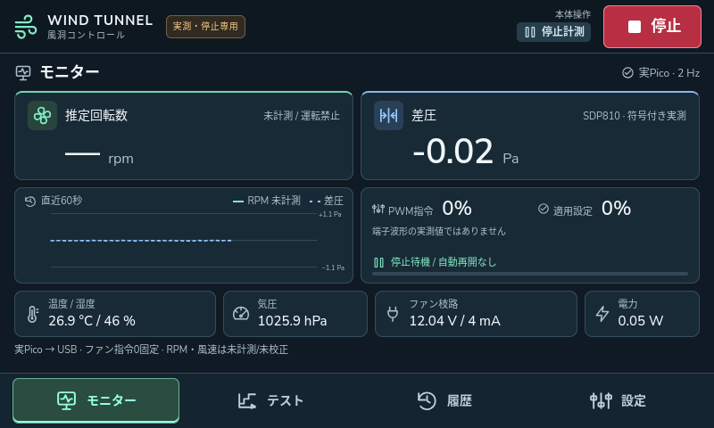

# Pico停止計測UIの実装と検証

2026年10月17日 / アプリ0.2.0 / Pico FW 0.2.0-monitor

Raspberry Piの800×480画面に、SDP810・BME280・INA260の実測値を表示する。ファンは指令0固定とし、実機運転のボタンとAPIを無効化した。遠隔モードONの10分制限は撤廃し、許可IPとAPIトークンの認証は維持する。

## 実機での表示

検証時の一例は差圧−0.0125 Pa、温度26.92℃、湿度46.17%、現地気圧102587 Pa、電圧12.038 V、電流3.75 mA、電力0.05 Wだった。UIは丸めて表示し、APIはPa・A・V・Wの値を返す。数値の桁数は精度保証ではなく、停止時の小さな差圧をゼロ補正で隠さない。INA260の量子化・内部平均により、表示電圧×表示電流と電力レジスター値は完全一致しない。

RPMはこのFWでは計測せず「—」、風速も配管対応・ゼロ点・校正未確定のためnullとする。指令0とGP16 LOWは確認できるが、羽根の物理停止をRPMから証明したものではない。

## 停止専用の構成

| 担当 | 実装 |
|---|---|
| Pico | boot.pyとmain.py冒頭でGP16をLOW。PWMオブジェクトや運転コマンドを作らない |
| センサー取得 | I2C0 GP0/1のSDP810 0x25、I2C1 GP2/3のBME280 0x77とINA260 0x40 |
| USB | 固定device_idのby-idポートを専用ワーカーが排他使用。通信断後は再オープンして取得再開 |
| Pi | 生フレームを検証・倍精度補正し、値・元データ・鮮度・個別エラーを保持 |
| UI | 約2 Hz更新。実測と模擬を常時識別。試験開始は無効 |
| API | 実機のruns/validate・runsは409 HARDWARE_MONITOR_ONLY。模擬障害注入も拒否 |
| 保存 | 実機設定はmonitor.sqlite3、旧模擬履歴はsimulation.sqlite3。最新値の連続DB保存は未実装 |

Pico FWは `Electronics/pico/firmware/monitor_main.py` を `main.py` として配備した。既存boot.pyは維持し、旧main.pyはPico内と検証ディレクトリーへ保存した。インストーラーは転送後SHA-256とdevice_id・FW版・LOW応答を確認する。運転版向けのWDT・Tach・運転許可の独立監視はまだ実装していない。

## センサー処理と品質

SDP810は差圧平均モード0x3615を使い、開始後5秒はWARMING_UPとして差圧を出さない。フレームと製品IDのCRCを確認し、±125 Paモデルのscale=240、温度scale=200を適用する。[Sensirion SDP8xxデータシート](https://sensirion.com/en/media/documents/90500156/6167E43B/Sensirion_Differential_Pressure_Datasheet_SDP8xx_Digital.pdf)

BME280はforced、温度・圧力・湿度各1倍、IIRなしで測定する。チップID・校正係数・データ長・無効値を検証し、Pi側でメーカー式に従い補正する。[Bosch BME280データシート](https://www.bosch-sensortec.com/media/boschsensortec/downloads/datasheets/bst-bme280-ds002.pdf)

INA260は電流と電圧のトリガー測定、16平均、各1.1 msを使用する。メーカーID・チップID・変換完了・オーバーフローを検証し、電流は符号付き1.25 mA/LSB、電圧1.25 mV/LSB、電力10 mW/LSBで換算する。[TI INA260データシート](https://www.ti.com/lit/ds/symlink/ina260.pdf)

各センサーは順に測定するため完全同時ではない。各読取り時刻をraw内に保持する。センサー1個の異常では、その値だけnullとし、他の正常値は取得を続ける。全体validはfalseになり、遠隔許可を取り消してfaultを保持する。原因復旧後の「異常解除」でも遠隔ONや運転を自動再開しない。USB断は全値をnull、受信停止から1.5秒超は古い値として扱う。

## USB契約

要求は1行のJSONで `{"cmd":"sample","id":"固有ID"}`、他にstatus・stopのみを受け付ける。Pico受信行は256文字、Pi受信フレームは4096 bytesまで。通常運用はREPL・任意コード実行・自動リセットを行わない。

応答はprotocol=1、firmware、device_id、boot_id、増加seq、pico_ms、要求id、ok、kind、fan_locked_stop=true、fan_enabled=false、fan_command_percent=0、gp16_level=0を含む。sample応答にはraw内のフレーム・校正係数・ID・取得時刻・個別errorsも含む。Piは対応要求・機器・FW・停止設定・seqを検証する。

USB分割受信は行末まで組み立て、無関係な過去の要求IDは無視する。同じboot_idでseqが逆転・重複すれば拒否する。Pico ticks_msの折返しは仕様内の値として受け付け、鮮度はPiの単調時計による実受信時刻で判定する。表示ポーリングで受信時刻を書き換えない。Pico時刻の拡張・精密な計数窓は将来のTach版で実装する。

## 遠隔許可の無期限化

ON中に経過時間でOFFへ戻す処理はない。APIは `unlimited=true`、`remaining_s=null`、`expires_at=null` を返し、旧duration_s入力は422で拒否する。個々の模擬試験の300秒制限は別であり維持する。

OFF・停止操作・アプリ再起動・機器異常・本体画面の生存確認5秒不達では安全のためOFFへ戻す。ON状態はディスクへ保存しない。本体画面が正常に生存確認を送る間は認証Cookieを更新し、8時間で一律失効しない。期限を過ぎて失効済みの認証は生存確認だけでは復活させない。

APIは引き続きPi内の127.0.0.1:8765だけで待ち受ける。LAN直接公開・TLSは後続工程。ONにしても今回の実機版でファンは回らない。

## 検証と証跡

PCとPiで自動テスト各66件が成功した。センサー補正の基準ベクトル、CRC・ID・無効フレーム、分割受信、seq、接続再試行、運転禁止、古い値、異常後の再許可なし、API認証を対象とする。遠隔許可は健全な生存確認を模した仮想時計で30時間進め、許可ID維持と認証更新を検証した。これは実時間30時間の耐久試験ではない。模擬UIの回帰試験も20項目成功した。

実機UIでは800×480に主要表示が収まること、30回の取得で全センサー正常・新しいseq・GP16 LOW・UI差圧とAPI値の丸め一致、実機運転拒否、遠隔ON無期限/OFF、ページ再読込を確認する。物理的なUSB抜差しやオシロ波形測定は行っていない。

サービス再起動後にも6項目の実機UI検証が成功し、USBを再オープンして正常取得へ戻った。最後は検証用9222番ポートを閉じて再起動し、実画面で停止計測・実Pico更新を確認した。待受は127.0.0.1:8765のみ、未認証statusは401、USB所有者は制御サービス1個、配備31ファイルのSHA-256一致を確認した。通常起動直後は描画前の空画面が見られたが、起動約1分後の撮影では上図の表示に復帰している。

- [実機UI検証と30回の生フレーム](ui-real-result.json)
- [PCの自動テスト結果](pc-tests.xml) と [Piの自動テスト結果](pi-tests.xml)
- [ファームウェア転送ハッシュと停止応答](firmware-install.json)
- [配備ソースのハッシュ](source-sha256.json)
- [通常運用へ戻した最終チェック](final-checks.txt)
- [操作と再配備](../../../../software/control/deploy/pi/README.md)

次の工程はTach常時計数、独立停止監視、有限運転、校正である。実測画面の完成をファン運転の安全性検証完了とは扱わない。
