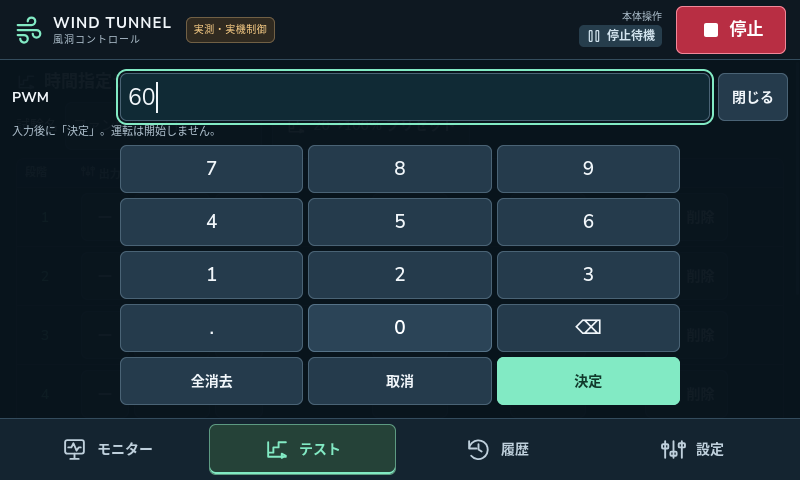
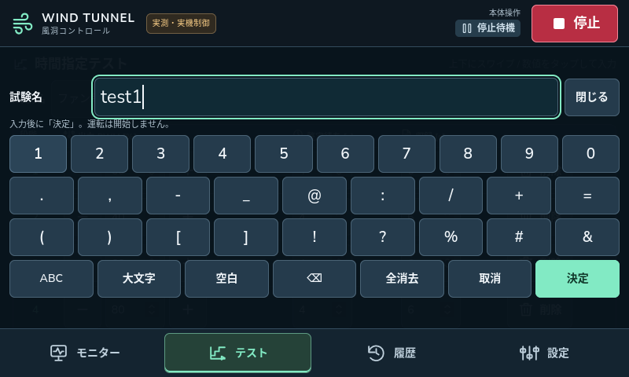

# タッチパネルの操作方法

2026年10月17日 / Pi配備版 `20261017-touch-ui-01`

中央の画面を指で上下に動かしてスクロールできます。数値や文字の入力には画面キーボードを追加しました。右上の「停止」と下部の画面切替はスクロールせず、キーボードを開いても操作できます。

## 操作する

| やりたいこと | 操作 |
|---|---|
| 下に隠れた設定・履歴・試験段階を見る | 中央領域を上にスワイプ。戻るときは下にスワイプ |
| PWM・時間・繰返しを変える | 数値欄をタップ → テンキー →「決定」|
| 試験名・クライアント名・許可IPを変える | 文字欄をタップ → 英数字・記号キー →「決定」|
| 数字と記号を入力する | 英字キーボードの「123」で切替。許可IPは数字・記号から開く |
| 編集をやめる |「取消」または「閉じる」。画面切替でも未確定の入力を破棄 |
| ファンを停止する | 右上の「停止」。入力中でも使える。遠隔許可もOFFになる |
| 外付けキーボードで直接入力する |「設定」→「タッチ操作」で画面キーボードをOFF |

入力欄やコピー用の文字列は通常の編集・選択を残しています。スクロールは見出し、余白、表のラベルから始めてください。タップとスワイプは移動量で区別し、ドラッグ後のクリックによる運転開始・行削除・遠隔ONを抑止します。右上の停止はこの抑止の対象外です。

入力中は背景の編集欄を操作できません。「決定」は値の反映だけで、ファンを回しません。従来の「条件を確認」→開始の手順を維持します。PWMは0、または20～100%です。未確定の値は停止操作でも破棄します。

画面キーボードは数字・英字・記号に対応します。日本語を新規入力する場合は外付けキーボードのIMEを使用してください。画面キーボードON/OFFは同じブラウザーセッションのページ再読込で維持し、専用ブラウザー再起動後は既定のONになります。

### Pi実画面：数値入力

### Pi実画面：文字入力

## 変更範囲と確認結果

変更はWeb UIと検証用コードに限定しました。Picoファームウェア、PWM・Tach取得、センサー配線、遠隔認証・運転時間の制約は変更していません。Piの既存の画面180度回転、タッチ補正、固定IPも維持しています。

| 確認環境 | 結果・対象 |
|---|---|
| PC / 模擬Pico / Chrome | タッチ操作10項目成功。マウスエミュレーションとネイティブtouchイベント、誤クリック抑止、入力検証、固定停止ボタン |
| PC / 模擬Pico / Chrome | 既存UI20項目成功 |
| PCとPi / 自動テスト | Python各94件成功。認証・制御・通信の回帰試験 |
| Pi実機 / 実Pico / Firefox | タッチ構成と同じマウスポインター経路で9項目成功。設定・段階表・既存履歴のスクロール、画面キー、範囲外入力の拒否、停止、再読込 |
| Pi実機の最終状態 | IDLE、実測有効、PWM指令0・適用0、RPM 0、遠隔OFF |

この改訂のPi実機試験では、ファンの運転開始や遠隔ONの要求は送っていません。表示中のレシピ編集は試験後に再読込で破棄し、既存の計測履歴を維持しました。停止・運転・回転数の実機試験結果は[前の実機制御検証](../pico-control/README.md)を参照してください。

通常起動へ戻した後、配備38ファイルのSHA-256一致、サービス稼働・再起動回数0、APIのloopback限定、未認証401、診断ポート9222の閉鎖を確認しました。履歴は6件のままで未終了試験はなく、DBの `quick_check` は `ok`。再起動後の実画面でもRPM 0・PWM指令0・適用0でした。旧リリースは保持しています。今回再起動したのはアプリサービスで、Pi全体の再起動試験は実施していません。

実際に指で触れたときの位置、押しやすさ、スクロールの感触は利用者による確認が残っています。今回の実機検証はブラウザーへの自動ポインター入力であり、物理タッチセンサーからの入力試験ではありません。

### 記録と再現

- [PCタッチ試験結果](pc-touch-result.json) / [Pi画面試験結果](ui-touch-result.json)
- [既存UIの回帰試験結果](pc-ui-result.json)
- [PC Python試験結果](pc-api-tests.xml) / [Pi Python試験結果](pi-api-tests.xml)
- [配備ファイルのSHA-256](source-sha256.json)
- [通常起動に戻したPi画面](pi-final-normal.png)
- PC再現：`software/control` で `node tests/touch_smoke.cjs`。独立した模擬サーバー・ブラウザーを使う。
- Pi再現：停止中に専用Firefoxの診断ポートを一時有効化し、`python3 deploy/pi/verify_touch.py` を実行。完了後は `WT_KIOSK_DEBUG` を解除してkioskサービスを再起動する。通常運用で診断ポートを開いたままにしない。

現在のPiはlabwcの `mouseEmulation="yes"` でタッチをマウス入力に変換するため、アプリにマウスドラッグのスクロール処理を追加しました。ネイティブtouch環境ではブラウザー自身のスクロールを使用し、二重に動かしません。[labwc設定仕様](https://labwc.github.io/labwc-config.5.html)、[MDN Pointer events](https://developer.mozilla.org/en-US/docs/Web/API/Pointer_events)、[MDN touch-action](https://developer.mozilla.org/en-US/docs/Web/CSS/Reference/Properties/touch-action)
