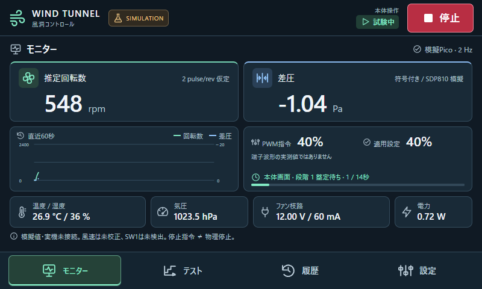

# 風洞センサー表示と制御UI API

2026年10月17日 / 0.3.0 実機有限運転版・タッチ操作対応

800×480タッチ画面用UIとHTTP APIです。Pi本体は実PicoのTach・SDP810・BME280・INA260をUSB経由で約2 Hz取得し、画面から有限時間のPWM試験を実行できます。開発PCの既定値はシミュレーションです。画面上部とAPIの `simulation` で区別し、保存先も分離します。

実機の通信仕様・検証・制限は[実機有限運転版](../../Docs/tests/software/pico-control/README.md)を参照してください。`pico-control` は運転可能、旧 `pico-monitor` は停止計測専用です。対応するPico FWと組み合わせて使用します。

Pi本体の全画面表示・再起動・保存先は[Pi配備と運用](deploy/pi/README.md)を参照してください。

## 起動する

このPCでは専用Python環境を作成済みです。PowerShellから次を実行します。

```powershell
Set-Location D:\codes\Wind_Tunnel\software\control
.\start-simulator.ps1
```

ブラウザーが開きます。サーバーは `127.0.0.1:8765` のみで待ち受け、LANへ公開しません。停止するには起動した端末でCtrl+Cを押します。実行ポリシーでスクリプトを起動できない場合は、ポリシーを変更せず次を使えます。

```powershell
.\.venv\Scripts\python.exe -m windtunnel --open
```

ブラウザーを自動起動しない場合は `--open` を省略し、生成された `.runtime/local-access.html` を開いてください。このリンクは本体操作用の一回限りの資格情報を含むので共有しないでください。URLのフラグメントは交換直後に消去します。ブラウザーの再読込ではCookieとタブ内CSRF情報を継続します。新しいタブで再認証する必要がある場合はアプリを再起動してください。

実行中は `http://127.0.0.1:8765/openapi.json` でAPIスキーマを取得できます。`localhost` など別のHost名は拒否します。`--port` と `--data-dir` は変更できますが、同じ保存先で複数の制御プロセスを起動できません。

### 別の開発PCで環境を準備する

Python 3.12以上を使い、グローバル環境へインストールせず専用環境を作成します。

```powershell
python -m venv .venv
.\.venv\Scripts\python.exe -m pip install -r requirements-dev.txt
.\.venv\Scripts\python.exe -m windtunnel --open
```

PCの確認環境はWindows / Python 3.12.14で、依存バージョンを固定しています。Pi armhfではOSが提供するFastAPI・uvicornを使用し、同じAPIテストを実行しています。PiにPC用のrequirementsをそのままpipインストールしないでください。

## 画面から操作する

| 画面 | 操作 |
|---|---|
| モニター | 2 Hzの推定RPM、符号付き差圧、温湿度、気圧、電圧・電流・電力、直近60秒の表示 |
| テスト | PWM・整定待ち・収録時間・繰返しを編集し、条件確認後に開始 |
| 履歴 | 試験条件と終了理由の確認、CSV/JSONのダウンロード、ページ切替 |
| 設定 | 遠隔ON/OFF、APIクライアント登録と失効、模擬障害の注入・原因解消・異常解除 |

各センサー・画面切替・操作は、統一したSVGアイコンと日本語ラベルで表示します。アイコンはアプリ内に同梱し、外部フォントやCDNを使いません。実行中・待機・異常は文字と記号を併記し、色だけに依存しません。回転数のグラフは実線、差圧は破線です。

試験の経過は進行バーと秒数で確認できます。履歴の「詳細」は結果・操作者・時間・終了理由を日本語で表示し、元のJSONは開発者向けの折りたたみ欄に残しています。通信断時は過去の値を薄くし、遠隔許可状態を「不明」、停止状態を「未確認」と表示します。



右上の停止は全画面・確認欄の表示中も使用できます。停止は試験を中止し、遠隔モードもOFFにします。画面を閉じる、別タブへ切り替えるなどして本体画面の生存確認が5秒途切れた場合も試験を停止します。再表示だけでは運転を再開しません。

### タッチパネルで操作する

- 中央の画面を上下にスワイプすると、テストの段階表・履歴・設定をスクロールできます。上部の停止と下部の画面切替は固定です。入力欄やコピー用の文字列からではなく、見出し・余白・表のラベルからスワイプしてください。
- 数値欄をタップするとテンキー、試験名や許可IPをタップすると英数字・記号キーボードが開きます。「決定」で入力値だけを反映します。運転開始には従来どおり条件確認と開始操作が必要です。
- 「取消」「閉じる」、画面切替、停止では未確定の入力を破棄します。キーボード表示中も右上の停止を使えます。
- 「設定」→「タッチ操作」の画面キーボードをOFFにすると、外付けキーボードで直接編集できます。選択は同じブラウザーセッションの再読込で維持します。専用ブラウザーを再起動した場合は既定のONになります。日本語入力は外付けキーボードのIMEを使ってください。

Piの既存のタッチ補正は変更せず、タッチがマウス入力に変換される構成にも対応しました。ドラッグ終了を開始・削除・遠隔ONのタップとして扱わないよう抑止します。操作画像と検証範囲は[タッチ操作の手引き](../../Docs/tests/software/touch-ui/README.md)を参照してください。

レシピは最大12段階、5回繰返し、合計300秒以内です。各段階はPWM 0または20–100%、整定待ち0–120秒、収録1–120秒。終了時は指令を0に戻します。プリセットは20→40→60→80→100%、実機では各段階4秒待ち＋6秒収録の計50秒、模擬版では2秒待ち＋3秒収録です。初めての運転は単一段階20%から確認してください。

整定待ち中のサンプルも保存し、`phase=settle/record` で区別します。時間が経っただけで定常状態を保証せず、`settled=null` とします。風速は校正前なので常にnull。SW1の位置はunknownです。PWM指令・Picoの適用設定・RPMは別々に表示し、停止指令と羽根の物理停止を同一視しません。

実機の開始前には12 V電源・SW1、センサー鮮度、停止中電流、Tach低下を検査します。`開始確認中 → 試験中 → 停止応答待ち` と進み、PicoがPWM 0を応答してから完了または中止になります。応答未確認や異常を正常完了として扱いません。回転数が0へ下がるまで羽根へ触れず、停止を確認できない場合はSW1をOFFにしてください。

Picoの通信更新期限は2秒、運転開始時に有効化するWDTは3秒です。USB切断・制御更新停止・センサー異常で停止し、復旧や異常解除だけでは再開しません。これらは試験用ソフト保護であり、安全認証された非常停止ではありません。

## 遠隔モードとAPI認証

外部操作には次の条件をすべて要求します。

1. 本体画面で遠隔モードをONにしていること。
2. 接続ソケットのIPが、そのクライアントの許可IPに一致。
3. 有効なBearerトークンが必要な操作権限を持つ。

「設定」で名前と個別IPを登録します。PC内でAPIを試す場合は `127.0.0.1` を使います。トークンは発行時に一度だけ表示し、サーバーはハッシュのみ保存します。「試験の開始・停止を許可」を外すとread/planのみです。CIDRやワイルドカードは許可しません。

遠隔ONに時間制限はありません。OFF・停止操作・異常・本体画面の生存確認が5秒途絶えた場合に許可を取り消し、再起動後は必ずOFFです。正常な本体画面の生存確認でローカル認証を更新するため、元の8時間Cookie期限で一律停止しません。トークン失効時もその所有者の試験を停止します。PWM上限・1試験300秒以内の制限は実機にも適用します。

状態読取りとレシピ検証は、IPとトークン権限が合えば遠隔OFFでも可能です。stop権限のあるクライアントは、遠隔OFFや他者所有でも停止できます。本体UIからの試験開始は遠隔モードをOFFにしてから行います。

本体用のCookie認証と外部Bearer認証は別経路です。外部トークンは本体設定権限へ昇格できません。`source=local` や転送ヘッダーを信用せず、uvicornのproxy_headersを無効化しています。ブラウザーの更新操作にはOrigin/CSRF検証を加え、Host固定、HttpOnly/SameSite Cookie、CSPも設定しています。ローカル管理者やOSアカウント自体の侵害は保護範囲外です。

APIトークンを平文LANへ送らないでください。この初版はloopback限定です。TLS・公開範囲・運用監査を整備してからLAN版へ進めます。IP制限だけを本人認証として扱いません。

### API利用例

模擬版と `pico-control` の運転APIは以下の順に呼びます。旧 `pico-monitor` ではruns/validate・runsを409で拒否します。本体画面は開いたままにします。トークンは環境変数か安全な入力方法で読み込み、コードや会話ログに保存しないでください。

1. `GET /api/v1/status`：control_epochと遠隔permit.idを取得。
2. `POST /api/v1/runs/validate`：recipeオブジェクトだけを送信。回転しない。
3. `POST /api/v1/runs`：下記JSONと固有の`Idempotency-Key`、`Authorization: Bearer …`を送信。
4. `GET /api/v1/runs/{id}`：202応答は受付なので、その後の状態を確認。
5. `GET /api/v1/runs/{id}/export?format=json`：条件とサンプルを取得。csvも利用可能。

```json
{
  "recipe": {
    "name": "API PWM40 test",
    "mode": "pwm",
    "steps": [{"pwm_percent": 40, "settle_s": 2, "record_s": 3}],
    "repeat": 1
  },
  "control_epoch": 1,
  "remote_permit_id": "statusから取得したID"
}
```

同じ要求を再送するときは同じ冪等キーを使います。同一キー・同一要求は同じrunを返し、完了後も再運転しません。同じキーで内容を変更すると409です。停止後はepochが変わるため、古い要求を新しいキーで送っても拒否します。遠隔モードOFF中は冪等な開始再送も拒否するので、既知のrun IDをGETしてください。運転キューはなく、同時開始は1件だけです。

## 保存と異常処理

PCでは `.runtime/simulation.sqlite3`、Pi実機では `~/.local/share/windtunnel-control/monitor/monitor.sqlite3` に条件、サンプル、API更新操作、クライアント設定を保存します。SQLiteはDELETE journal、単一制御ロック、短いトランザクションを使います。書込み不能を検出したら停止を要求し、異常を保持します。保存できなかった最終状態は再起動後INTERRUPTEDになる場合があります。元データを無断で削除しません。

`.runtime` はGit対象外です。ランチャーはPOSIXで所有者専用権限、Windowsでは現在のユーザー向けACLを設定します。履歴・資格情報を含むので他者へ渡さないでください。起動時の一回限りリンクは正常終了時に削除します。端末を強制終了した場合に残ったリンクは、旧プロセス終了後には使えません。

模擬障害はPico接続断・センサー異常・電源異常を選べます。異常を起こした後は「原因を解消」→「異常解除」の順で操作します。解除だけでは試験を再開しません。実ハードウェアの電気的保護・WDTの代わりではありません。

## テストする

```powershell
New-Item -ItemType Directory -Path .runtime -Force | Out-Null
.\.venv\Scripts\python.exe -m pytest -q --basetemp=.runtime/pytest-temp
```

`--basetemp` はpytestが再実行時に消去する専用テスト領域です。実データの保存先を指定しないでください。

ブラウザー試験はNode.jsとPlaywright、WindowsではChromeを使います。既存のChromeプロファイルやタブには触れず、新しいヘッドレス環境を作ります。

```powershell
node tests/ui_smoke.cjs
node tests/touch_smoke.cjs
```

Playwrightが外部の共有ランタイムにある場合は`NODE_PATH`をそのnode_modulesへ設定します。画像と結果は`test-results`へ保存します。通常のUI試験は8766番・`.runtime/ui-*`、タッチ試験は8767番・専用の模擬保存先を使います。実ファンは動かしません。

## 次の工程

Pico常時Tach計数、有限PWM、独立停止監視とUI運転を実装しました。次は長時間運用の評価、圧力配管・ゼロ点・風速の校正です。RPM一定制御、SSE、定常判定、履歴の統計比較、LAN/TLSは未実装です。待機中の全サンプルはDBへ連続保存せず、最新値と画面内トレンドを提供します。運転中は取得seqで重複を避け、欠落があれば `missed_acquisitions_before` に保存します。

設計全体は[制御ソフトウェア基本設計](../../Docs/software/control-software/README.md)、検証結果は[VERIFICATION.md](VERIFICATION.md)を参照してください。
