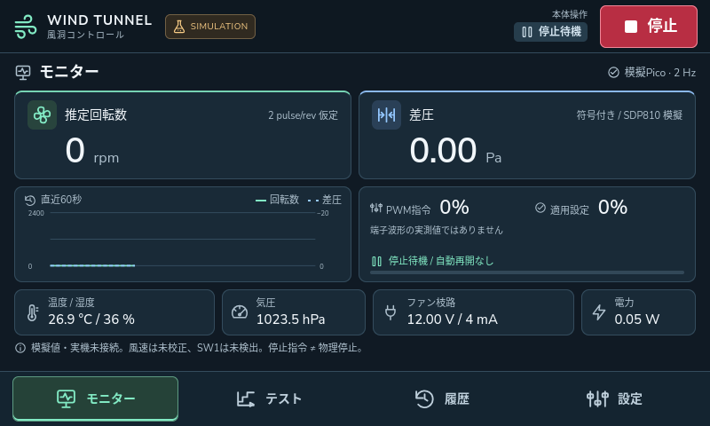

# 風洞UIとAPIの検証記録

## タッチ操作対応（20261017-touch-ui-01）

上下スワイプ、数値テンキー、英数字・記号キーボード、ドラッグ後の誤クリック抑止を追加した。PCのタッチ操作10項目、既存UI20項目、Pythonテスト94件が成功。PiでもPython94件と実Firefoxのポインター操作9項目が成功した。Picoファームウェア・OSの180度回転・タッチ補正・API認証仕様は変更していない。

Piの現在のタッチ構成はlabwcのマウスエミュレーションで、その入力経路をブラウザーの自動操作で検証した。PCではネイティブtouchイベントも検証したが、実際に指で触れたときの操作感は未検証。Pi検証では運転開始・遠隔ON要求を送らず、最後は実測有効、PWM指令0・適用0、RPM 0、遠隔OFFだった。詳しい手順・画面・生データは[タッチ操作の手引きと検証](../../Docs/tests/software/touch-ui/README.md)を参照する。

## 0.3.0 実機有限運転版

PicoのGP15ハードウェア回転計数、GP16 PWM、有限運転と独立停止を実装した。PCとPiで各94件、模擬UI20項目が成功。実機UIで20%低速、20～100%段階、停止ボタンを検証した。最終段階試験は102有効サンプル、取得欠落・重複0。drive更新を止めた試験では約2.177秒後にPicoのLEASE_EXPIREDとPWM 0を観測した。詳細・制約・生データは[実機有限運転版の検証](../../Docs/tests/software/pico-control/README.md)を参照する。

以下は過去版の履歴であり、現行版の運転制限を示すものではない。

## 0.2.0 停止専用実測版

実Picoのセンサー3種をPiのUIへ接続した。ファン運転は禁止し、遠隔許可を無期限へ変更した。PCとPiの自動テスト、実画面の30回連続実測・停止設定・表示一致を検証した。最新の仕様と証跡は[停止専用実測版の検証](../../Docs/tests/software/pico-monitor/README.md)を参照する。

以下は0.1.0模擬版配備時の履歴であり、当時の期限付き許可と旧Pico FWの結果を記録している。現在の仕様ではない。

## 0.1.0 模擬版の履歴

2026年10月17日 / 0.1.0 アイコン付きUI改訂 / Windows、Python 3.12.14、ヘッドレスChrome

**PC上のAPI自動テスト39件とブラウザー操作20項目に加え、Pi本体でもAPI39件・画面操作8項目が成功しました。** いずれも模擬PicoのUI・API検証です。実センサー取得や実ファン運転の検証ではありません。Pi配備時には実Picoへ停止状態の照会のみを行っています。

## APIと制御処理

`tests/test_api.py` をpytestで実行し、39 passed / 4.27秒を確認しました。UI改訂でAPIの認証・制御ロジックや依存パッケージは変更していません。

| 検証対象 | 確認結果 |
|---|---|
| 認証なし・loopbackだけの接続 | 本体資格情報もBearerもないAPIアクセスは401 |
| 遠隔ON・IP・トークン | 3条件の欠落を拒否。すべて成立すると開始受付 |
| 接続元・本体権限の偽装 | X-Forwarded-For、source=local、外部トークンによる本体設定を拒否 |
| Origin / Host / CSRF | 不一致と欠落を拒否。大きな入力も拒否 |
| 許可IP | 個別IPv4/IPv6のみ。CIDR、ワイルドカード、ホスト名、scope付きIPv6を拒否 |
| トークン権限と失効 | read/planのみでは運転不可。失効で所有試験を停止。DBはハッシュ保存 |
| 遠隔OFF・期限・本体画面消失 | 模擬運転を停止し、許可を失効。読取りとstop権限は別管理 |
| 排他・停止後の古い要求 | 同時運転を拒否。古いepoch/permitによる開始を拒否 |
| 冪等性 | 6並列の同一開始が1つのrun。同一キーの内容変更を拒否。完了後再送で再運転なし |
| 入力値 | PWM低速未許可域、範囲外、合計時間超過、空段階、NaN、未知フィールド等を拒否 |
| 保存と単位 | 整定/収録を区別。Pa、A、V、Wとsimulation識別をCSV/JSONへ保存 |
| 模擬障害 | 接続断・センサー・給電異常で停止。原因解消と解除後も再開なし |
| 保存失敗 | 書込失敗時に模擬PWMを0、異常保持 |
| 予期しない内部例外 | 模擬PWMを0、実行runを停止し異常保持 |
| 再起動 | 保存済み未完了runはINTERRUPTED、遠隔OFF、PWM 0。冪等記録は保持 |
| 多重起動 | 同じ保存フォルダーに2つの制御プロセスを作ることをOSロックで防止 |

テストクライアントに、httpxの将来置換に関するStarletteの非推奨警告が1件あります。テスト失敗ではなく、HTTPサーバー実行時の警告ではありません。テスト環境を更新する際にhttpx2への移行を確認します。

## ブラウザー操作

`tests/ui_smoke.cjs` は独立したヘッドレスChromeを800×480と1280×800で実行しました。既存ユーザーのChromeタブには触れていません。

1. 一回限りの本体認証とURLフラグメント消去。
2. 再読込でセッションを継続。
3. 模擬センサーとトレンドを表示。
4. 条件確認後に有限試験を開始。
5. 開始受付後の応答を意図的に破棄し、再送しても同一runに留まることを確認。
6. 停止ボタンで試験を中止。
7. 履歴とCSVダウンロードを確認。
8. 遠隔モードON/OFF。
9. APIトークンの発行と失効。
10. 実HTTP APIから模擬試験を開始し、本体画面の遠隔OFFでCANCELLEDになることを確認。
11. 模擬障害の発生、原因解消、異常解除。自動再開なし。
12. 開始確認欄が表示されていても停止ボタンが画面内に残ることを確認。
13. ローカルSVGアイコンが描画され、装飾用アイコンはスクリーンリーダーの読み上げから除外。
14. 選択中の画面をaria-currentで識別。可視ボタンのラベルと、停止・ナビゲーションの高さ48px以上を確認。
15. 通常のモニター画面が800×480でスクロールせず収まることを確認。
16. 成功通知、エラー通知、試験中を別の状態表示にすることを確認。
17. 履歴詳細が日本語で要約され、元のJSONは初期状態で折りたたまれていることを確認。
18. 通信断時に過去の値・遠隔許可不明・停止未確認を表示し、復旧時に表示が回復。
19. 1280×800でも停止ボタン・選択画面を維持し、横スクロールが発生しないことを確認。
20. アイコンを含め、外部サイトへのアセット要求が発生しないことを確認。

JavaScriptのpage errorは0件。画像は原寸で確認し、モニターの主要値と4画面ナビゲーションが収まることを確認しました。段階表・履歴・設定は中央領域をスクロールし、上部の停止ボタンは固定します。物理タッチパネルでの操作感は未検証です。

## 残件

- 長時間運用のメモリ・冷却・ログ容量、物理タッチの操作感、8時間の認証期限後の復帰案内。
- 常駐PicoとのUSBプロトコル、実Tach計数、PWM、独立watchdog、切断時停止。
- LAN公開前のTLS、認証の運用強化、アクセス拒否の監査、ログ容量・ディスク監視。
- SSE、定常判定、統計比較、圧力対応と校正、風速表示。

模擬アプリは実機の停止時間やハードウェア安全性を保証しません。現在のロック＋同期DB処理も、実機版では独立停止監視と負荷試験を伴う再評価が必要です。

生の自動テスト結果は`test-results/api-tests.xml`、`test-results/ui-result.json`、画面画像とCSVは同じフォルダーにあります。今回の表示改訂の記録は`Docs/tests/software/ui-icons`にも保存しています。再現手順は[README](README.md)を参照してください。

## Pi本体への配備と検証

2026年10月17日、Pi 3 B+ / Raspbian 13 armhf / Python 3.13.5に模擬版を配備しました。PiのOS提供ライブラリでAPIテスト39件が9.36秒で成功しました。Linuxの即時サービス再起動に対応するソケット再利用も修正し、PC側のAPI39件は4.72秒で再成功しています。

Firefox 151.0.3の専用全画面プロファイルで、次の8項目を確認しました。自動操作はブラウザーのポインター入力であり、実タッチパネルを指で触る検証ではありません。

1. 本体認証後の画面が800×480で表示される。
2. 横方向にはみ出さず、通常モニターが収まり、停止ボタンは高さ48px以上、SVGアイコンが描画される。
3. 画面操作で有限の模擬試験を開始し、予定時間で自動終了する。
4. 完了した模擬試験が履歴に表示される。
5. 画面の停止ボタンで模擬試験を中止する。
6. 画面から遠隔ON/OFFが切り替わり、最後はOFFになる。
7. ページ再読込後も本体認証を維持する。
8. 最終API状態がsimulation=true、IDLE、PWM指令0、遠隔OFFで、模擬テレメトリーが更新される。

Pi全体を再起動し、起動IDの変更、同じ`<PI_IP>`へのSSH再接続、ユーザーサービスの自動起動、Firefoxの実画面表示を確認しました。認証なしのstatus取得は401、待受は127.0.0.1:8765のみ、検証用9222番ポートは閉鎖済みです。Picoは `0.1.0-commissioning`、`fan_enabled=false`、`gp16_level=0` を返しました。アプリからPicoへの運転指令はありません。

再起動から約184秒後の5秒間サンプルでは、全CPUコアを合計した使用率は7.2%、使用可能メモリ455 MiB、swap使用0 MiB、SoC温度52.6℃でした。これは短時間の停止待機時の測定で、長時間試験の保証ではありません。`get_throttled=0x80000` は過去のsoft temperature limit到達を示し、測定時点では現在の制限ビットは立っていません。冷却確認を継続事項とします。[Raspberry Pi公式の状態ビット](https://www.raspberrypi.com/documentation/computers/os.html#get_throttled)

Chromium 149では画面を描画できず、Firefoxに切り替えて検証を完了しました。既存の画面180度回転、タッチ補正、固定IP、Picoファームウェアは変更していません。Pi用のOS依存パッケージ20個を追加し、OS全体の更新や削除は行っていません。

証跡は `Docs/tests/software/pi-deployment/` の `api-tests.xml`、`ui-full-result.json`、`postboot.json`、`resources.json`、`pi-packages.txt`、実画面PNGです。配備・停止・再起動の操作は[Pi配備と運用](deploy/pi/README.md)に記載しています。
